## Neurodegenerative disease and reproductive health in Chile {#slide-1 .cover}

```{=html}
<div class="text-area"><p>Routine records, reproductive histories and care context</p></div>

<p class="interpretation-limit">Recorded disease, reported cognitive symptoms and contextual exposures support different inferences.</p>

<div class="source-footer">Sources: <a href="https://deis.minsal.cl/#datosabiertos">DEIS mortality</a>, <a href="https://public.tableau.com/views/PropuestaTableroGRD/PropuestaTableroGRD?:showVizHome=no">FONASA GRD</a>, <a href="https://observatorio.ministeriodesarrollosocial.gob.cl/encuesta-casen-2024">CASEN 2024 (MDSF)</a>, <a href="https://deis.minsal.cl/#datosabiertos">DEIS/MINSAL REM</a></div>
```

::: {.notes}

DEIS mortality: https://deis.minsal.cl/#datosabiertos

FONASA GRD: https://public.tableau.com/views/PropuestaTableroGRD/PropuestaTableroGRD?:showVizHome=no

CASEN 2024 (MDSF): https://observatorio.ministeriodesarrollosocial.gob.cl/encuesta-casen-2024

DEIS/MINSAL REM: https://deis.minsal.cl/#datosabiertos

:::

## Two complementary parts of the project {#slide-2 .statement}

```{=html}
<div class="text-area"><p>Part 1 describes recorded neurodegenerative burden, diagnostic coding and variation across centres.</p><p>Part 2 examines reproductive histories, ovarian surgery and menopausal hormone therapy (MHT).</p><p>BSO is the configured bilateral/remaining-ovary removal flag.</p></div>

<p class="interpretation-limit">Different populations and windows. Survey respondents do not link to surgery or individual treatment records.</p>

<div class="source-footer">Sources: <a href="https://deis.minsal.cl/#datosabiertos">DEIS mortality</a>, <a href="https://public.tableau.com/views/PropuestaTableroGRD/PropuestaTableroGRD?:showVizHome=no">FONASA GRD</a>, <a href="https://observatorio.ministeriodesarrollosocial.gob.cl/encuesta-casen-2024">CASEN 2024 (MDSF)</a>, <a href="https://deis.minsal.cl/#datosabiertos">DEIS/MINSAL REM</a></div>
```

::: {.notes}

DEIS mortality: https://deis.minsal.cl/#datosabiertos

FONASA GRD: https://public.tableau.com/views/PropuestaTableroGRD/PropuestaTableroGRD?:showVizHome=no

CASEN 2024 (MDSF): https://observatorio.ministeriodesarrollosocial.gob.cl/encuesta-casen-2024

DEIS/MINSAL REM: https://deis.minsal.cl/#datosabiertos

:::

## Part 1: routine sources retain distinct observation units {#slide-3 .source-table}

```{=html}
<div class="table-area"><table data-table-id="descriptive-table-1"><colgroup><col style="width:34.722222%"><col style="width:26.909722%"><col style="width:38.368056%"></colgroup><thead><tr><th scope="col">Source</th><th scope="col">Period</th><th scope="col">Volume</th></tr></thead><tbody><tr><td>DEIS deaths</td><td>2002–2024*</td><td>2 371 230</td></tr><tr><td>DEIS discharges</td><td>2001–2024</td><td>38 818 057</td></tr><tr><td>GRD</td><td>2019–2024</td><td>5 808 535</td></tr></tbody></table></div>

<p class="selection-label">*2024 deaths preliminary, cut-off 23 June 2026. Source-volume extract from Table 1.</p>

<p class="interpretation-limit">All-cause source volumes. Deaths, discharges and GRD episodes are neither pooled nor linked.</p>

<div class="source-footer">Sources: <a href="https://deis.minsal.cl/#datosabiertos">DEIS mortality</a>, <a href="https://deis.minsal.cl/#datosabiertos">DEIS hospital discharges</a>, <a href="https://public.tableau.com/views/PropuestaTableroGRD/PropuestaTableroGRD?:showVizHome=no">FONASA GRD</a></div>

<div class="figure-link">Table D1 excerpt</div>
```

::: {.notes}

Data sources and observation units

*Deaths in 2024 are preliminary and displayed separately; trends use 2002–2023 only. Sources are neither pooled nor linked to each other. Included facilities form a sample defined by programme availability and enrolment criteria, rather than all primary-care providers. Annual caseload snapshots may repeatedly include the same person.

Rows 0–2 and columns 0, 1 and 3 of reviewed Table 1. All source volumes retained exactly.

DEIS mortality: https://deis.minsal.cl/#datosabiertos

DEIS hospital discharges: https://deis.minsal.cl/#datosabiertos

FONASA GRD: https://public.tableau.com/views/PropuestaTableroGRD/PropuestaTableroGRD?:showVizHome=no

:::

## Mortality rises strongly with age at death {#slide-4 .hero}

```{=html}
<div class="figure-area"><div class="panel-window" data-figure-key="descriptive-1" data-crop="[0, 0.075, 0.5, 0.425]" style="left:315.54933px;top:37.60000px;width:520.90133px;height:432.40000px"></div><div class="panel-legend" style="left:288.0px;top:0px;width:576.0px;height:37.6px"><span><span style="color:#AD2D65">●</span> Women</span><span><span style="color:#216A94">■</span> Men</span></div></div>

<p class="interpretation-limit">Underlying cause, 2019–2023. Age at death does not identify age at clinical onset.</p>

<div class="source-footer">Sources: <a href="https://deis.minsal.cl/#datosabiertos">DEIS mortality</a>, <a href="https://www.ine.gob.cl/estadisticas-por-tema/demografia-y-poblacion/estimaciones-y-proyecciones-de-poblacion">INE national base-2024</a></div>

<div class="figure-link"><a href="../outputs/paper/revision_descriptiva_2026-10-28/figures/Figure1_age_sources_en.png" target="_blank">Complete original figure</a></div>
```

::: {.notes}

Figure 1. Age and sex patterns across routine sources. A: age-specific mortality with dementia or parkinsonism as underlying cause, 2019–2023, with 95% confidence intervals; all positive counts are shown, including those below five. Zero counts are not plotted on the logarithmic axis. B–D: female-to-male ratios of age-standardised rates with 95% confidence intervals by age class at recorded event. The threshold of at least five records in each sex applies only to ratios in B–D; absent symbols do not indicate zero. Series represent deaths (2019–2023), GRD episodes (2019–2024), first observed GRD records per person (2021–2024), REM A05 entries (2019–2025), and programme caseload/dependency in December 2024. Each source retains its unit and denominator; counts are not pooled or interpreted as incidence. G10–G11 denotes Huntington disease and hereditary ataxias. Ages refer to recorded events or death, not clinical onset. Sources: DEIS, GRD, REM and INE.

Original figure: outputs/paper/revision_descriptiva_2026-10-28/figures/Figure1_age_sources_en.png. Panel windows preserve its data, scales and labels.

DEIS mortality: https://deis.minsal.cl/#datosabiertos

INE national base-2024: https://www.ine.gob.cl/estadisticas-por-tema/demografia-y-poblacion/estimaciones-y-proyecciones-de-poblacion

:::

## Sex ratios depend on age and recording source {#slide-5 .hero}

```{=html}
<div class="figure-area"><div class="panel-window" data-figure-key="descriptive-1" data-crop="[0.51, 0.075, 0.49, 0.425]" style="left:43.64454px;top:0.00000px;width:477.19091px;height:404.20000px"></div><div class="panel-window" data-figure-key="descriptive-1" data-crop="[0, 0.52, 0.5, 0.39]" style="left:604.44585px;top:0.00000px;width:530.62831px;height:404.20000px"></div><div class="panel-window" data-figure-key="descriptive-1" data-crop="[0.2, 0.925, 0.73, 0.06]" style="left:224.67470px;top:413.60000px;width:702.65060px;height:56.40000px"></div></div>

<p class="interpretation-limit">Dementia left, parkinsonism right. Source-specific windows and denominators remain distinct.</p>

<div class="source-footer">Sources: <a href="https://deis.minsal.cl/#datosabiertos">DEIS mortality</a>, <a href="https://public.tableau.com/views/PropuestaTableroGRD/PropuestaTableroGRD?:showVizHome=no">FONASA GRD</a>, <a href="https://deis.minsal.cl/#datosabiertos">DEIS/MINSAL REM</a>, <a href="https://www.ine.gob.cl/estadisticas-por-tema/demografia-y-poblacion/estimaciones-y-proyecciones-de-poblacion">INE national base-2024</a></div>

<div class="figure-link"><a href="../outputs/paper/revision_descriptiva_2026-10-28/figures/Figure1_age_sources_en.png" target="_blank">Complete original figure</a></div>
```

::: {.notes}

Figure 1. Age and sex patterns across routine sources. A: age-specific mortality with dementia or parkinsonism as underlying cause, 2019–2023, with 95% confidence intervals; all positive counts are shown, including those below five. Zero counts are not plotted on the logarithmic axis. B–D: female-to-male ratios of age-standardised rates with 95% confidence intervals by age class at recorded event. The threshold of at least five records in each sex applies only to ratios in B–D; absent symbols do not indicate zero. Series represent deaths (2019–2023), GRD episodes (2019–2024), first observed GRD records per person (2021–2024), REM A05 entries (2019–2025), and programme caseload/dependency in December 2024. Each source retains its unit and denominator; counts are not pooled or interpreted as incidence. G10–G11 denotes Huntington disease and hereditary ataxias. Ages refer to recorded events or death, not clinical onset. Sources: DEIS, GRD, REM and INE.

Original figure: outputs/paper/revision_descriptiva_2026-10-28/figures/Figure1_age_sources_en.png. Panel windows preserve its data, scales and labels.

DEIS mortality: https://deis.minsal.cl/#datosabiertos

FONASA GRD: https://public.tableau.com/views/PropuestaTableroGRD/PropuestaTableroGRD?:showVizHome=no

DEIS/MINSAL REM: https://deis.minsal.cl/#datosabiertos

INE national base-2024: https://www.ine.gob.cl/estadisticas-por-tema/demografia-y-poblacion/estimaciones-y-proyecciones-de-poblacion

:::

## Mortality trends vary across the observation period {#slide-6 .hero}

```{=html}
<div class="figure-area"><div class="panel-window" data-figure-key="descriptive-2" data-crop="[0, 0, 1, 0.5]" style="left:94.73247px;top:0.00000px;width:962.53507px;height:470.00000px"></div></div>

<p class="interpretation-limit">Directly standardised mortality with 95% CIs. Open symbols mark preliminary 2024 data.</p>

<div class="source-footer">Sources: <a href="https://deis.minsal.cl/#datosabiertos">DEIS mortality</a>, <a href="https://www.ine.gob.cl/estadisticas-por-tema/demografia-y-poblacion/estimaciones-y-proyecciones-de-poblacion">INE national base-2024</a></div>

<div class="figure-link"><a href="../outputs/paper/revision_descriptiva_2026-10-28/figures/Figure2_trends_coding_en.png" target="_blank">Complete original figure</a></div>
```

::: {.notes}

Figure 2. Mortality trends and coding, 2002–2024. A–B: age-standardised mortality rates at all ages in women and men; bands indicate 95% confidence intervals. Open symbols identify preliminary 2024 data, released with a cut-off of 23 June 2026. C: female-to-male dementia mortality ratios for all ages and age ≥65, with 95% confidence intervals; the horizontal line indicates equal rates. D: proportions of dementia deaths coded as Alzheimer disease, unspecified dementia or vascular dementia by sex. These categories do not necessarily exhaust the broad dementia definition; this panel describes underlying-cause coding rather than clinically validated subtypes. Rates and ratios come from the mortality tables and do not represent the Poisson-regression trend in death counts. Sources: DEIS deaths and INE; WHO standard population.

Original figure: outputs/paper/revision_descriptiva_2026-10-28/figures/Figure2_trends_coding_en.png. Panel windows preserve its data, scales and labels.

DEIS mortality: https://deis.minsal.cl/#datosabiertos

INE national base-2024: https://www.ine.gob.cl/estadisticas-por-tema/demografia-y-poblacion/estimaciones-y-proyecciones-de-poblacion

:::

## Dementia sex ratios and underlying-cause coding changed {#slide-7 .hero}

```{=html}
<div class="figure-area"><div class="panel-window" data-figure-key="descriptive-2" data-crop="[0, 0.54, 1, 0.46]" style="left:94.73247px;top:37.60000px;width:962.53507px;height:432.40000px"></div><div class="panel-legend" style="left:288.0px;top:0px;width:576.0px;height:37.6px"><span><span style="color:#AD2D65">●</span> Women</span><span><span style="color:#216A94">■</span> Men</span></div></div>

<p class="interpretation-limit">Coding proportions describe recorded underlying causes. They do not identify the causes of rate changes.</p>

<div class="source-footer">Sources: <a href="https://deis.minsal.cl/#datosabiertos">DEIS mortality</a>, <a href="https://www.ine.gob.cl/estadisticas-por-tema/demografia-y-poblacion/estimaciones-y-proyecciones-de-poblacion">INE national base-2024</a></div>

<div class="figure-link"><a href="../outputs/paper/revision_descriptiva_2026-10-28/figures/Figure2_trends_coding_en.png" target="_blank">Complete original figure</a></div>
```

::: {.notes}

Figure 2. Mortality trends and coding, 2002–2024. A–B: age-standardised mortality rates at all ages in women and men; bands indicate 95% confidence intervals. Open symbols identify preliminary 2024 data, released with a cut-off of 23 June 2026. C: female-to-male dementia mortality ratios for all ages and age ≥65, with 95% confidence intervals; the horizontal line indicates equal rates. D: proportions of dementia deaths coded as Alzheimer disease, unspecified dementia or vascular dementia by sex. These categories do not necessarily exhaust the broad dementia definition; this panel describes underlying-cause coding rather than clinically validated subtypes. Rates and ratios come from the mortality tables and do not represent the Poisson-regression trend in death counts. Sources: DEIS deaths and INE; WHO standard population.

Original figure: outputs/paper/revision_descriptiva_2026-10-28/figures/Figure2_trends_coding_en.png. Panel windows preserve its data, scales and labels.

DEIS mortality: https://deis.minsal.cl/#datosabiertos

INE national base-2024: https://www.ine.gob.cl/estadisticas-por-tema/demografia-y-poblacion/estimaciones-y-proyecciones-de-poblacion

:::

## Recorded comorbidities span cardiometabolic and geriatric conditions {#slide-8 .hero}

```{=html}
<div class="figure-area"><div class="panel-window" data-figure-key="descriptive-S15" data-crop="[0.1, 0.05, 0.8, 0.255]" style="left:62.47958px;top:-0.00000px;width:1027.04084px;height:394.80000px">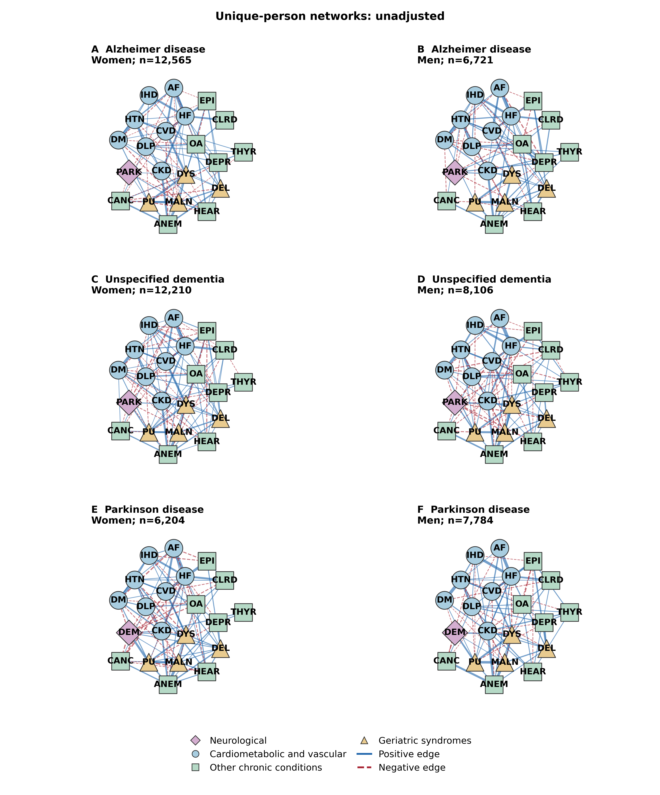</div><div class="native-scientific-legend" style="position:absolute;left:23.04px;top:406.55px;width:345.59999999999997px;height:28.2px;font:20px Arial;color:#916C96">◆ Neurological</div><div class="native-scientific-legend" style="position:absolute;left:391.68px;top:406.55px;width:391.68px;height:28.2px;font:20px Arial;color:#416F80">● Cardiometabolic / vascular</div><div class="native-scientific-legend" style="position:absolute;left:806.4px;top:406.55px;width:345.59999999999997px;height:28.2px;font:20px Arial;color:#3D6E53">■ Other chronic conditions</div><div class="native-scientific-legend" style="position:absolute;left:23.04px;top:437.1px;width:345.59999999999997px;height:28.2px;font:20px Arial;color:#926A1B">▲ Geriatric syndromes</div><div class="native-scientific-legend" style="position:absolute;left:391.68px;top:437.1px;width:391.68px;height:28.2px;font:20px Arial;color:#216A94">Solid blue: positive edge</div><div class="native-scientific-legend" style="position:absolute;left:806.4px;top:437.1px;width:345.59999999999997px;height:28.2px;font:20px Arial;color:#B22C43">Dashed red: negative edge</div></div>

<p class="interpretation-limit">Unadjusted, 2021–2024. First eligible year per person, age ≥60. Global tests do not establish equivalence.</p>

<div class="source-footer">Sources: <a href="https://public.tableau.com/views/PropuestaTableroGRD/PropuestaTableroGRD?:showVizHome=no">FONASA GRD</a></div>

<div class="figure-link"><a href="../outputs/paper/revision_descriptiva_2026-10-28/bank/figures/FigureS15_unique_unadjusted_en.png" target="_blank">Complete original figure</a></div>
```

::: {.notes}

Figure S15. Unadjusted comorbidity networks of unique people aged ≥60 with recorded public-hospital GRD episodes in 2021–2024, including day surgery and other coded activities. Rows show Alzheimer disease (A–B), unspecified dementia (C–D) and Parkinson disease (E–F); women are on the left and men on the right. Each person contributes their first eligible year and all diagnoses from episodes in that year; identifiers with discordant recorded sex are excluded. Alzheimer disease and unspecified dementia are disjoint at baseline; Parkinson disease may coexist with dementia. Edges are selected regularised partial correlations estimated with graphical lasso on tetrachoric correlations, EBIC γ=0.5 and a 50-point penalty-grid rule. These networks are not conditioned on age or coding depth. All selected non-zero edges are retained. Figures S15 and S16 share one deterministic layout, constant node area and the same edge-width scale across all twelve panels. Solid blue edges are positive; dashed red edges are negative. Shapes and colours distinguish predefined communities. Node size does not encode prevalence or centrality. Edge counts depend on sample size and selection threshold. Associations among recorded diagnoses are descriptive and do not identify causal mechanisms. PARK, parkinsonism; DEM, dementia (replaces PARK in Parkinson disease networks); HTN, hypertension; DM, diabetes; DLP, dyslipidaemia; IHD, ischaemic heart disease; HF, heart failure; AF, atrial fibrillation or flutter; CVD, cerebrovascular disease; CKD, chronic kidney disease; THYR, hypothyroidism; CLRD, chronic lower respiratory disease; OA, osteoarthritis; CANC, cancer; HEAR, hearing loss; EPI, epilepsy; DEPR, depression; ANEM, anaemia (non-acute); DEL, delirium; PU, pressure ulcer; DYS, dysphagia; MALN, malnutrition.

Original figure: outputs/paper/revision_descriptiva_2026-10-28/bank/figures/FigureS15_unique_unadjusted_en.png. Panel windows preserve its data, scales and labels.

FONASA GRD: https://public.tableau.com/views/PropuestaTableroGRD/PropuestaTableroGRD?:showVizHome=no

The displayed Alzheimer disease networks are unadjusted. The full unique-person analysis includes 56,923 people and eight specified global contrasts per test family. Holm-adjusted global strength and structure tests did not reject at 0.05. This does not demonstrate equivalence. Network edges describe conditional associations among hospital-coded conditions.

:::

## Dementia registration varies beyond Poisson funnel limits {#slide-9 .hero}

```{=html}
<div class="figure-area"><div class="panel-window" data-figure-key="descriptive-4" data-crop="[0, 0, 1, 0.45]" style="left:127.06677px;top:0.00000px;width:897.86645px;height:413.60000px"></div><div class="panel-window" data-figure-key="descriptive-4" data-crop="[0.25, 0.947, 0.7, 0.04]" style="left:134.08136px;top:418.30000px;width:883.83729px;height:51.70000px"></div></div>

<p class="interpretation-limit">Selected centres, age ≥60, 2019–2025. O/E and funnel limits are descriptive registration measures.</p>

<div class="source-footer">Sources: <a href="https://deis.minsal.cl/#datosabiertos">DEIS/MINSAL REM</a>, <a href="https://public.tableau.com/views/ReporteInscritosCentrosAPS/ReporteAPS?:showVizHome=no">FONASA APS enrolment</a></div>

<div class="figure-link"><a href="../outputs/paper/revision_descriptiva_2026-10-28/figures/Figure4_centres_en.png" target="_blank">Complete original figure</a></div>
```

::: {.notes}

Figure 4. Variation in dementia and Parkinson registration between primary-care centres, 2019–2025. A–B: REM A05 dementia entries at age ≥60, observed/expected (O/E) per centre against expected records based on internal sex- and age-specific rates (60–79 and ≥80) and FONASA enrolment. Poisson control limits are 95% (dashed) and 99.8% (dotted); triangles identify values outside the 99.8% limits. All centres and zeros are retained; x axis is logarithmic and y axis uses symlog with a linear segment from 0 to 0.25. C: Poisson–gamma smoothed O/E in both sexes, restricted to centres with ≥5 expected records in each sex; diagonal: equality; Spearman ρ is calculated in this common sample. D: percentage of between-centre variance attributable to municipality differences from the random-intercept model of log smoothed O/E in the original analysis sample; hatched grey denotes variation within municipalities. These are neither clinical risk intervals nor validated performance indicators. Sources: REM, FONASA and DEIS establishment catalogue. In D, n denotes centres: entries, 638 in 276 municipalities; dementia caseload, 730 in 288 municipalities; Parkinson caseload, 766 in 292 municipalities. Within each outcome, the same samples are used for both sexes.

Original figure: outputs/paper/revision_descriptiva_2026-10-28/figures/Figure4_centres_en.png. Panel windows preserve its data, scales and labels.

DEIS/MINSAL REM: https://deis.minsal.cl/#datosabiertos

FONASA APS enrolment: https://public.tableau.com/views/ReporteInscritosCentrosAPS/ReporteAPS?:showVizHome=no

:::

## Registration patterns correlate between sexes {#slide-10 .hero}

```{=html}
<div class="figure-area"><div class="panel-window" data-figure-key="descriptive-4" data-crop="[0, 0.51, 1, 0.42]" style="left:29.40922px;top:0.00000px;width:1093.18155px;height:470.00000px"></div></div>

<p class="interpretation-limit">Concordance uses 673 centres. Municipal variance uses different precision-restricted samples by outcome.</p>

<div class="source-footer">Sources: <a href="https://deis.minsal.cl/#datosabiertos">DEIS/MINSAL REM</a>, <a href="https://public.tableau.com/views/ReporteInscritosCentrosAPS/ReporteAPS?:showVizHome=no">FONASA APS enrolment</a></div>

<div class="figure-link"><a href="../outputs/paper/revision_descriptiva_2026-10-28/figures/Figure4_centres_en.png" target="_blank">Complete original figure</a></div>
```

::: {.notes}

Figure 4. Variation in dementia and Parkinson registration between primary-care centres, 2019–2025. A–B: REM A05 dementia entries at age ≥60, observed/expected (O/E) per centre against expected records based on internal sex- and age-specific rates (60–79 and ≥80) and FONASA enrolment. Poisson control limits are 95% (dashed) and 99.8% (dotted); triangles identify values outside the 99.8% limits. All centres and zeros are retained; x axis is logarithmic and y axis uses symlog with a linear segment from 0 to 0.25. C: Poisson–gamma smoothed O/E in both sexes, restricted to centres with ≥5 expected records in each sex; diagonal: equality; Spearman ρ is calculated in this common sample. D: percentage of between-centre variance attributable to municipality differences from the random-intercept model of log smoothed O/E in the original analysis sample; hatched grey denotes variation within municipalities. These are neither clinical risk intervals nor validated performance indicators. Sources: REM, FONASA and DEIS establishment catalogue. In D, n denotes centres: entries, 638 in 276 municipalities; dementia caseload, 730 in 288 municipalities; Parkinson caseload, 766 in 292 municipalities. Within each outcome, the same samples are used for both sexes.

Original figure: outputs/paper/revision_descriptiva_2026-10-28/figures/Figure4_centres_en.png. Panel windows preserve its data, scales and labels.

DEIS/MINSAL REM: https://deis.minsal.cl/#datosabiertos

FONASA APS enrolment: https://public.tableau.com/views/ReporteInscritosCentrosAPS/ReporteAPS?:showVizHome=no

:::

## Santiago dementia entries vary between centres {#slide-11 .hero}

```{=html}
<div class="figure-area"><div class="panel-window" data-figure-key="descriptive-5" data-crop="[0.04, 0.62, 0.48, 0.235]" style="left:265.16129px;top:0.00000px;width:621.67742px;height:376.00000px"></div><div class="panel-window" data-figure-key="descriptive-5" data-crop="[0.11, 0.87, 0.36, 0.047]" style="left:328.30040px;top:380.70000px;width:495.39919px;height:79.90000px"></div></div>

<p class="interpretation-limit">2019–2025. Smoothed O/E (log scale). Women left, men right. ▼&lt;1, ▲≥1. National sample: 637 selected centres, age ≥60.</p>

<div class="source-footer">Sources: <a href="https://deis.minsal.cl/#datosabiertos">DEIS/MINSAL REM</a>, <a href="https://public.tableau.com/views/ReporteInscritosCentrosAPS/ReporteAPS?:showVizHome=no">FONASA APS enrolment</a>, <a href="https://www.bcn.cl/siit/siit/mapas_vectoriales/">BCN cartography</a></div>

<div class="figure-link"><a href="../outputs/paper/revision_descriptiva_2026-10-28/figures/Figure5_maps_en.png" target="_blank">Complete original figure</a></div>
```

::: {.notes}

Figure 5. Spatial distribution of dementia registration in primary-care centres, 2019–2025. A–B: Poisson–gamma smoothed O/E of dementia entries at age ≥60 in women and men. C–D: local LISA clusters and spatial outliers by sex. E–H: the same centres in the Santiago enlargement, indicated by rectangles on the national maps. The original spatial sample of 637 centres is retained (precision criteria, rural-post exclusion and available coordinates); this sample does not represent the entire primary-care network. O/E colour limits are shared and logarithmic, from 0.25 to 4; colourbar extensions indicate observations beyond these limits, shown in the extreme colour. Each LISA category uses both shape and colour: High–High and Low–Low indicate local concordance; High–Low and Low–High indicate outliers. LISA uses log O/E, eight nearest neighbours, 999 conditional resamples with replacement and p<0.05 without multiple-comparison correction; clusters are exploratory. Coordinates are WGS84; aspect ratios are adjusted for mean latitude; scale bars are approximate (250 km nationally and 10 km in Santiago). Mainland Chile is shown with regional boundaries and Santiago with municipal boundaries; oceanic and Antarctic territories are omitted. Sources: REM, FONASA, DEIS and project-derived cartography. Downward triangles indicate O/E<1 and upward triangles O/E≥1 in the O/E maps.

Original figure: outputs/paper/revision_descriptiva_2026-10-28/figures/Figure5_maps_en.png. Panel windows preserve its data, scales and labels.

DEIS/MINSAL REM: https://deis.minsal.cl/#datosabiertos

FONASA APS enrolment: https://public.tableau.com/views/ReporteInscritosCentrosAPS/ReporteAPS?:showVizHome=no

BCN cartography: https://www.bcn.cl/siit/siit/mapas_vectoriales/

BCN/SIIT 2017 public regional and municipal boundaries, simplified in the project. Official source: https://www.bcn.cl/siit/siit/mapas_vectoriales/. The source image also contains the full national views; these slides display Santiago panels only. Cartography is referential.

:::

## Local spatial clusters remain exploratory {#slide-12 .hero}

```{=html}
<div class="figure-area"><div class="panel-window" data-figure-key="descriptive-5" data-crop="[0.52, 0.62, 0.475, 0.235]" style="left:260.70917px;top:0.00000px;width:630.58165px;height:385.40000px"></div><div class="panel-window" data-figure-key="descriptive-5" data-crop="[0.62, 0.88, 0.3, 0.055]" style="left:399.60786px;top:390.10000px;width:352.78427px;height:79.90000px"></div></div>

<p class="interpretation-limit">Women left, men right. LISA p&lt;0.05 is nominal without multiple-comparison correction.</p>

<div class="source-footer">Sources: <a href="https://deis.minsal.cl/#datosabiertos">DEIS/MINSAL REM</a>, <a href="https://public.tableau.com/views/ReporteInscritosCentrosAPS/ReporteAPS?:showVizHome=no">FONASA APS enrolment</a>, <a href="https://www.bcn.cl/siit/siit/mapas_vectoriales/">BCN cartography</a></div>

<div class="figure-link"><a href="../outputs/paper/revision_descriptiva_2026-10-28/figures/Figure5_maps_en.png" target="_blank">Complete original figure</a></div>
```

::: {.notes}

Figure 5. Spatial distribution of dementia registration in primary-care centres, 2019–2025. A–B: Poisson–gamma smoothed O/E of dementia entries at age ≥60 in women and men. C–D: local LISA clusters and spatial outliers by sex. E–H: the same centres in the Santiago enlargement, indicated by rectangles on the national maps. The original spatial sample of 637 centres is retained (precision criteria, rural-post exclusion and available coordinates); this sample does not represent the entire primary-care network. O/E colour limits are shared and logarithmic, from 0.25 to 4; colourbar extensions indicate observations beyond these limits, shown in the extreme colour. Each LISA category uses both shape and colour: High–High and Low–Low indicate local concordance; High–Low and Low–High indicate outliers. LISA uses log O/E, eight nearest neighbours, 999 conditional resamples with replacement and p<0.05 without multiple-comparison correction; clusters are exploratory. Coordinates are WGS84; aspect ratios are adjusted for mean latitude; scale bars are approximate (250 km nationally and 10 km in Santiago). Mainland Chile is shown with regional boundaries and Santiago with municipal boundaries; oceanic and Antarctic territories are omitted. Sources: REM, FONASA, DEIS and project-derived cartography. Downward triangles indicate O/E<1 and upward triangles O/E≥1 in the O/E maps.

Original figure: outputs/paper/revision_descriptiva_2026-10-28/figures/Figure5_maps_en.png. Panel windows preserve its data, scales and labels.

DEIS/MINSAL REM: https://deis.minsal.cl/#datosabiertos

FONASA APS enrolment: https://public.tableau.com/views/ReporteInscritosCentrosAPS/ReporteAPS?:showVizHome=no

BCN cartography: https://www.bcn.cl/siit/siit/mapas_vectoriales/

BCN/SIIT 2017 public regional and municipal boundaries, simplified in the project. Official source: https://www.bcn.cl/siit/siit/mapas_vectoriales/. The source image also contains the full national views; these slides display Santiago panels only. Cartography is referential.

:::

## Part 2: family history associations differ by sex {#slide-13 .hero}

```{=html}
<div class="figure-area"><div class="panel-window" data-figure-key="base-1" data-crop="[0, 0, 1, 1]" style="left:94.60969px;top:0.00000px;width:962.78061px;height:470.00000px">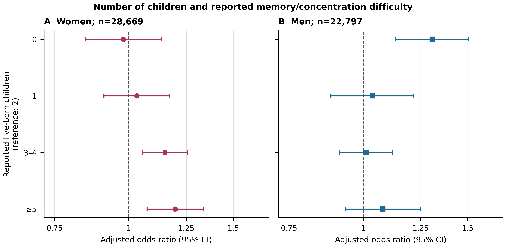</div></div>

<p class="interpretation-limit">Reported difficulty, age ≥60; adjusted associations with validated survey uncertainty.</p>

<div class="source-footer">Sources: <a href="https://observatorio.ministeriodesarrollosocial.gob.cl/encuesta-casen-2024">CASEN 2024 (MDSF)</a></div>

<div class="figure-link"><a href="../outputs/publication_programme_2026-10-28/figures/Figure1_reproductive_history.png" target="_blank">Complete original figure</a></div>
```

::: {.notes}

Figure 1. Number of reported live-born children and any self-reported remembering or concentrating difficulty in CASEN 2024 respondents aged 60 years or older. A: women; B: men. Two children is the reference. Points are weighted logistic odds ratios adjusted for age group, schooling, rural residence, harmonised region, FONASA status and indigenous identification. Intervals use full-frame survey linearisation and R survey domain-model residual degrees of freedom; coefficients and standard errors were independently reproduced in Python and R. All four displayed contrasts per sex are retained. The joint parity-by-sex F test evaluates the four interactions together and does not imply that each individual contrast differs by sex. These are cross-sectional associations in complete-case respondents, not dementia diagnoses, cognitive decline or effects of pregnancy or hormones. The odds ratio is not a prevalence ratio. No participant linkage to GRD surgery or REM treatment records is available.

Original figure: outputs/publication_programme_2026-10-28/figures/Figure1_reproductive_history.png. Panel windows preserve its data, scales and labels.

CASEN 2024 (MDSF): https://observatorio.ministeriodesarrollosocial.gob.cl/encuesta-casen-2024

The global parity×sex test has p=0.000464. All eight reference-to-two contrasts are retained.

:::

## Reported difficulty rises across older age groups {#slide-14 .hero}

```{=html}
<div class="figure-area"><div class="panel-window" data-figure-key="survey-extension-1" data-crop="[0, 0, 1, 0.5]" style="left:1.20560px;top:0.00000px;width:1149.58879px;height:470.00000px">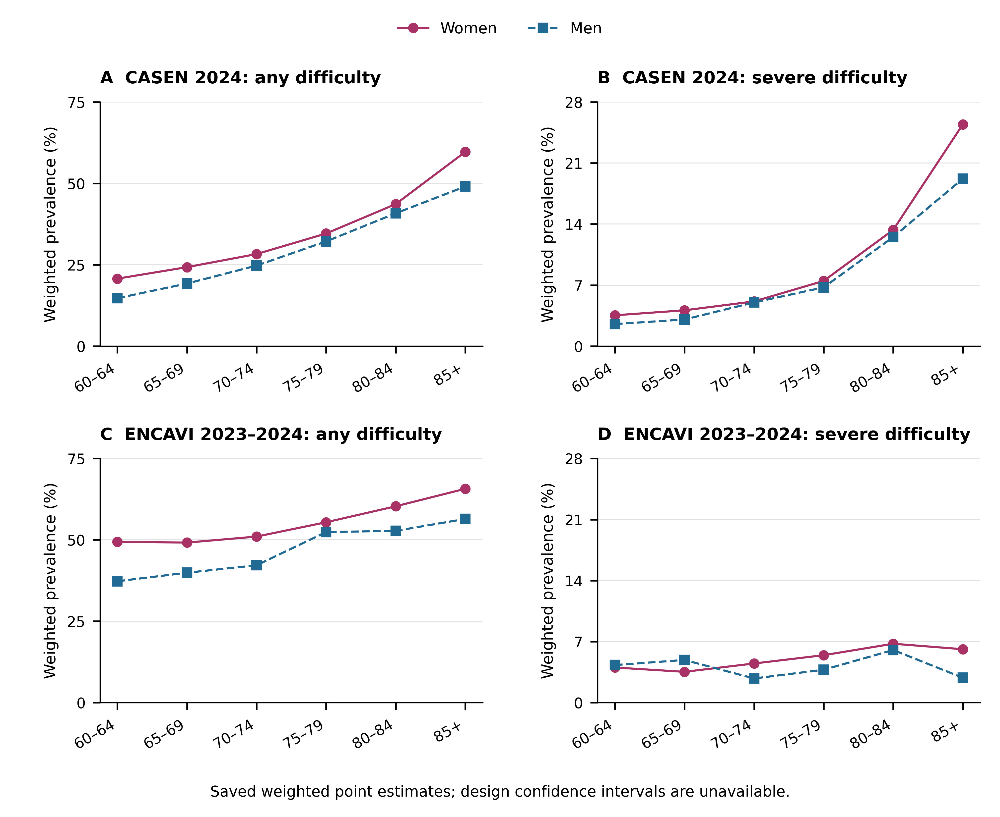</div></div>

<p class="interpretation-limit">Selected analytic sample; saved weighted points have no recoverable design CIs.</p>

<div class="source-footer">Sources: <a href="https://observatorio.ministeriodesarrollosocial.gob.cl/encuesta-casen-2024">CASEN 2024 (MDSF)</a></div>

<div class="figure-link"><a href="../outputs/publication_programme_2026-10-28/survey_extension/figures/survey_age_profiles.png" target="_blank">Complete original figure</a></div>
```

::: {.notes}

Figure 2. Age-specific weighted remembering/concentrating difficulty in the saved reproductive-history analytic samples. Panels A–B show CASEN 2024 and C–D ENCAVI 2023–2024; any and severe outcomes use separate labelled y scales, common within each outcome across instruments. Sex is encoded by colour and marker/line pattern. Values are weighted point estimates only; the saved source lacks design variances, so confidence intervals are unavailable. Lines join observed age-group summaries and do not represent longitudinal trajectories. CASEN severe means categories 3–4 and ENCAVI severe categories 4–5. ENCAVI uses a different health-related item and has an unresolved target-coverage/calibration conflict; between-instrument differences are not interpreted as disease differences.

Original figure: outputs/publication_programme_2026-10-28/survey_extension/figures/survey_age_profiles.png. Panel windows preserve its data, scales and labels.

CASEN 2024 (MDSF): https://observatorio.ministeriodesarrollosocial.gob.cl/encuesta-casen-2024

:::

## Severe difficulty models remain provisional {#slide-15 .hero}

```{=html}
<div class="figure-area"><div class="panel-window" data-figure-key="survey-extension-2" data-crop="[0, 0.49, 1, 0.46]" style="left:21.14849px;top:37.60000px;width:1109.70303px;height:432.40000px">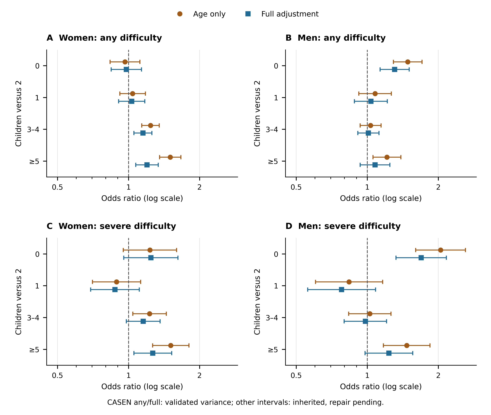</div><div class="panel-legend" style="left:230.4px;top:0px;width:691.1999999999999px;height:37.6px"><span><span style="color:#A05A17">●</span> Age only</span><span><span style="color:#216A94">■</span> Full adjustment</span></div></div>

<p class="interpretation-limit">CASEN categories 3–4; inherited nominal intervals still need domain repair.</p>

<div class="source-footer">Sources: <a href="https://observatorio.ministeriodesarrollosocial.gob.cl/encuesta-casen-2024">CASEN 2024 (MDSF)</a></div>

<div class="figure-link"><a href="../outputs/publication_programme_2026-10-28/survey_extension/figures/survey_casen_adjustment.png" target="_blank">Complete original figure</a></div>
```

::: {.notes}

Figure 3. CASEN 2024 child-number associations with any and severe self-reported difficulty, retaining every contrast versus two children in women and men aged 60 or older. Panels A–B show any difficulty and C–D severe difficulty. Orange circles show age-only and blue squares fully adjusted logistic odds ratios with available nominal 95% intervals. Fully adjusted any-difficulty intervals are the independently validated R survey t intervals; age-only and severe intervals remain inherited normal intervals with domain repair pending. The horizontal axis is logarithmic. Adjustment can change both the covariate set and the analytic sample; shifts are descriptive and do not identify confounding removal or mediation. Severe means categories 3–4. These outcomes are not diagnosed dementia or cognitive decline.

Original figure: outputs/publication_programme_2026-10-28/survey_extension/figures/survey_casen_adjustment.png. Panel windows preserve its data, scales and labels.

CASEN 2024 (MDSF): https://observatorio.ministeriodesarrollosocial.gob.cl/encuesta-casen-2024

:::

## ENCAVI uses a different symptom scale {#slide-16 .hero}

```{=html}
<div class="figure-area"><div class="panel-window" data-figure-key="survey-extension-3" data-crop="[0, 0.49, 1, 0.46]" style="left:21.14849px;top:37.60000px;width:1109.70303px;height:432.40000px">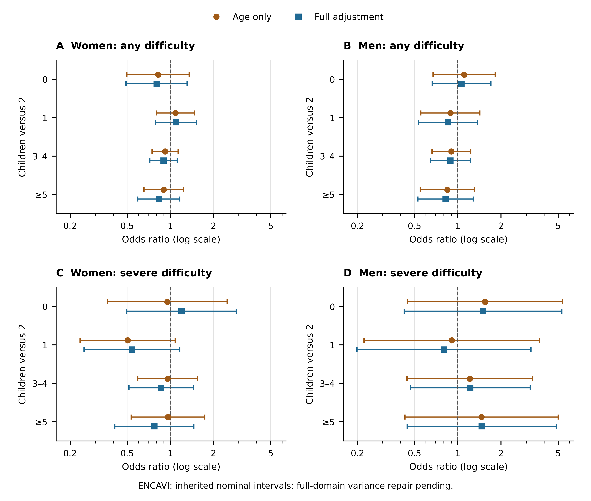</div><div class="panel-legend" style="left:230.4px;top:0px;width:691.1999999999999px;height:37.6px"><span><span style="color:#A05A17">●</span> Age only</span><span><span style="color:#216A94">■</span> Full adjustment</span></div></div>

<p class="interpretation-limit">Severe 4–5; inherited CIs. Coverage/calibration of the prepared sample remain unresolved.</p>

<div class="source-footer">Sources: <a href="https://epi.minsal.cl/wp-content/uploads/2025/08/Informe_metodologico_ENCAVI_2023_2024.pdf">ENCAVI methodology (MINSAL)</a>, <a href="https://epi.minsal.cl/wp-content/uploads/2025/08/Manual_de_base_de_datos_ENCAVI_2023_2024.pdf">ENCAVI data manual (MINSAL)</a></div>

<div class="figure-link"><a href="../outputs/publication_programme_2026-10-28/survey_extension/figures/survey_encavi_separate.png" target="_blank">Complete original figure</a></div>
```

::: {.notes}

Figure 4. ENCAVI 2023–2024 analysed as a separate instrument: all stored child-number contrasts versus two children for any and severe health-related remembering/concentrating difficulty in prepared ENCAVI respondents aged 60 or older. Any means categories 2–5; severe means 4–5. Orange circles show age-only and blue squares age/education/region-adjusted odds ratios. The logarithmic axis retains all nominal 95% source intervals, including wide intervals; full-domain variance repair has not been executed because the external person files are unavailable. This survey asks whether/how many children respondents have rather than explicit lifetime live births. The panels cannot establish direct replication, absence of association or equivalence with CASEN.

Original figure: outputs/publication_programme_2026-10-28/survey_extension/figures/survey_encavi_separate.png. Panel windows preserve its data, scales and labels.

ENCAVI methodology (MINSAL): https://epi.minsal.cl/wp-content/uploads/2025/08/Informe_metodologico_ENCAVI_2023_2024.pdf

ENCAVI data manual (MINSAL): https://epi.minsal.cl/wp-content/uploads/2025/08/Manual_de_base_de_datos_ENCAVI_2023_2024.pdf

:::

## Procedure records overlap and repeat people {#slide-17 .hero}

```{=html}
<div class="figure-area"><div class="panel-window" data-figure-key="surgery-extension-1" data-crop="[0, 0, 1, 0.435]" style="left:0.00000px;top:8.02946px;width:1152.00000px;height:453.94108px">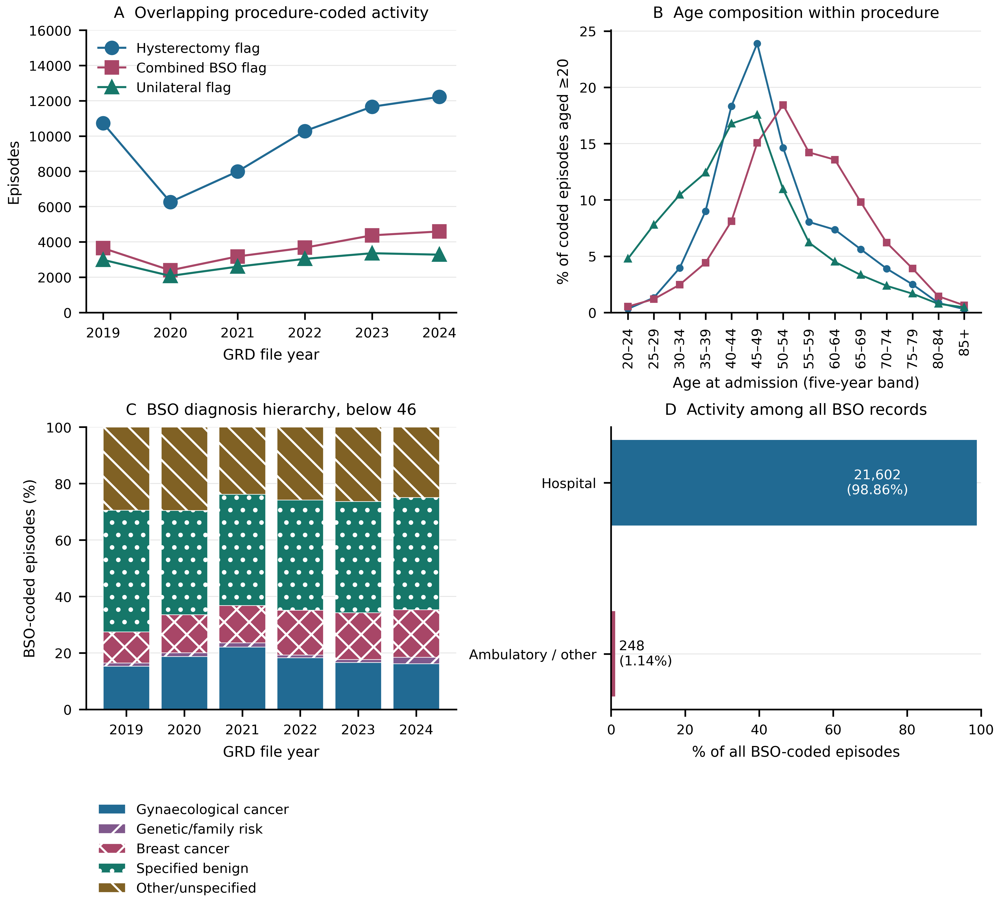</div></div>

<p class="interpretation-limit">Public GRD, 2019–2024; recorded activity is not national incidence.</p>

<div class="source-footer">Sources: <a href="https://public.tableau.com/views/PropuestaTableroGRD/PropuestaTableroGRD?:showVizHome=no">FONASA GRD</a></div>

<div class="figure-link"><a href="../outputs/publication_programme_2026-10-28/surgery_extension/figures/surgery_extension_activity_composition.png" target="_blank">Complete original figure</a></div>
```

::: {.notes}

Figure 6. Procedure-coded activity and case composition in public-hospital GRD file years 2019–2024. A: annual episodes with hysterectomy, combined BSO or unilateral flags; the groups overlap. B: distribution across five-year age bands among episodes aged at least 20, expressed within each procedure group; curves are composition, not population incidence. C: annual hierarchical diagnosis composition among BSO-coded episodes below 46, including the small number below age 20; categories are mutually exclusive under the stated any-position hierarchy. D: hospital versus ambulatory/other activity among all BSO-coded episodes, across all ages and indications. The combined BSO flag merges both-ovary and remaining-ovary codes. No menopause, clinical appropriateness, provider performance or causal interpretation is assigned. These are descriptive recorded counts without stochastic intervals.

Original figure: outputs/publication_programme_2026-10-28/surgery_extension/figures/surgery_extension_activity_composition.png. Panel windows preserve its data, scales and labels.

FONASA GRD: https://public.tableau.com/views/PropuestaTableroGRD/PropuestaTableroGRD?:showVizHome=no

:::

## BSO coding in the primary adult denominator {#slide-18 .numeric-anchor}

```{=html}
<div class="table-area"><table data-table-id="surgery-age-table"><colgroup><col style="width:15.190972%"><col style="width:21.267361%"><col style="width:19.097222%"><col style="width:12.152778%"><col style="width:32.291667%"></colgroup><thead><tr><th scope="col">Age at admission</th><th scope="col">Hysterectomy episodes</th><th scope="col">Same-episode BSO</th><th scope="col">BSO %</th><th scope="col">Wilson 95% reference interval</th></tr></thead><tbody><tr><td>20–39</td><td>4164</td><td>260</td><td>6.24</td><td>5.55–7.02</td></tr><tr><td>40–45</td><td>10648</td><td>863</td><td>8.10</td><td>7.60–8.64</td></tr></tbody></table></div>

<div class="headline-stat"><strong>7.58%</strong><span>1,123 of 14,812 specified-benign hysterectomy episodes, ages 20–45</span></div>

<p class="selection-label">Primary adult age rows; 2 of 5 age rows shown</p>

<p class="interpretation-limit">Specified-benign diagnoses, age 20–45; coding does not establish operative indication.</p>

<div class="source-footer">Sources: <a href="https://public.tableau.com/views/PropuestaTableroGRD/PropuestaTableroGRD?:showVizHome=no">FONASA GRD</a></div>

<div class="figure-link">Table 10 excerpt</div>
```

::: {.notes}

Same-episode BSO among specified-benign hysterectomy episodes by adult age

Pooled 2019–2024. Age is the floored inherited admission-age proxy; menopausal status is unavailable. All groups use the specified-benign hierarchy, excluding higher-priority cancer/risk categories and other/unspecified. Unadjusted Wilson intervals assume independent episodes and do not include provider clustering or coding uncertainty.

2 of 5 source rows shown; all 5 selected columns kept exactly

FONASA GRD: https://public.tableau.com/views/PropuestaTableroGRD/PropuestaTableroGRD?:showVizHome=no

:::

## Diagnosis definitions change the observed proportion {#slide-19 .hero}

```{=html}
<div class="figure-area"><div class="panel-window" data-figure-key="surgery-extension-2" data-crop="[0.465, 0, 0.535, 0.5]" style="left:298.41635px;top:0.00000px;width:555.16731px;height:470.00000px">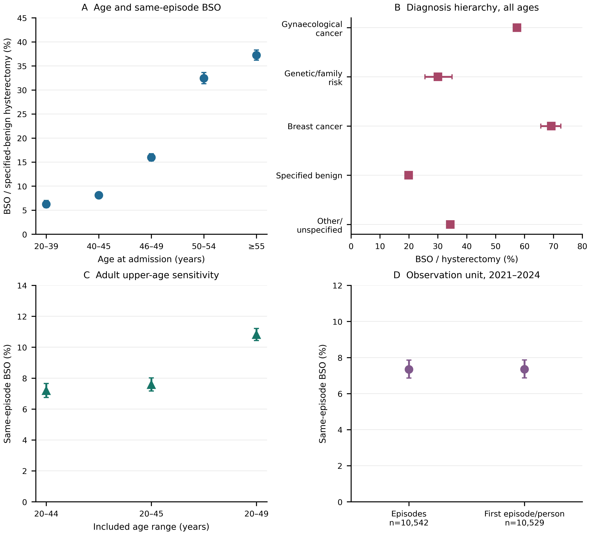</div></div>

<p class="interpretation-limit">Panel B includes all ages; BSO flags also include removal of a remaining ovary.</p>

<div class="source-footer">Sources: <a href="https://public.tableau.com/views/PropuestaTableroGRD/PropuestaTableroGRD?:showVizHome=no">FONASA GRD</a></div>

<div class="figure-link"><a href="../outputs/publication_programme_2026-10-28/surgery_extension/figures/surgery_extension_denominator_sensitivity.png" target="_blank">Complete original figure</a></div>
```

::: {.notes}

Figure 7. Denominator and observation-unit sensitivities for BSO coding at hysterectomy. A: pooled 2019–2024 specified-benign episodes at adult ages, with the exact numerators and denominators in the accompanying age table. B: all-age 2019–2024 hysterectomy episodes under each mutually exclusive diagnosis hierarchy category; this population differs from A. C: specified-benign episodes restricted to adult age ranges 20–44, 20–45 and 20–49; changing the upper age changes case mix. D: all eligible age 20–45 episodes in GRD file years 2021–2024 versus the first observed eligible episode per valid person identifier in those file years. Counts with missing identifiers are excluded only from the person sensitivity. Whiskers are unadjusted Wilson 95% binomial reference intervals; episode intervals assume independent episodes, and none includes provider clustering or coding/selection uncertainty. The comparison does not establish equivalence or effects of age, surgery or clinical care. No BSO code does not confirm preserved ovarian tissue; the BSO flag includes remaining-ovary removal.

Original figure: outputs/publication_programme_2026-10-28/surgery_extension/figures/surgery_extension_denominator_sensitivity.png. Panel windows preserve its data, scales and labels.

FONASA GRD: https://public.tableau.com/views/PropuestaTableroGRD/PropuestaTableroGRD?:showVizHome=no

:::

## No subsequent neurological admission was recorded {#slide-20 .metric}

```{=html}
<div class="metric-area"><strong>0</strong><p>later-admission dementia or Parkinson-related records</p></div>

<div class="metric-context"><p>774 people with BSO coding; 9,755 without a BSO code.</p><p>First eligible observed hysterectomy in comparable GRD file years 2021–2024.</p></div>

<p class="interpretation-limit">Short, incomplete capture prevents an effect or safety comparison.</p>

<div class="source-footer">Sources: <a href="https://public.tableau.com/views/PropuestaTableroGRD/PropuestaTableroGRD?:showVizHome=no">FONASA GRD</a></div>
```

::: {.notes}

FONASA GRD: https://public.tableau.com/views/PropuestaTableroGRD/PropuestaTableroGRD?:showVizHome=no

All six source outcome/group cells are exactly zero: dementia, parkinsonism and Parkinson disease in each group. Strictly later admission is not a diagnosis date.

:::

## MHT recording increased during 2019–2025 {#slide-21 .hero}

```{=html}
<div class="figure-area"><div class="panel-window" data-figure-key="base-3" data-crop="[0, 0, 1, 0.5]" style="left:43.38640px;top:0.00000px;width:1065.22721px;height:470.00000px">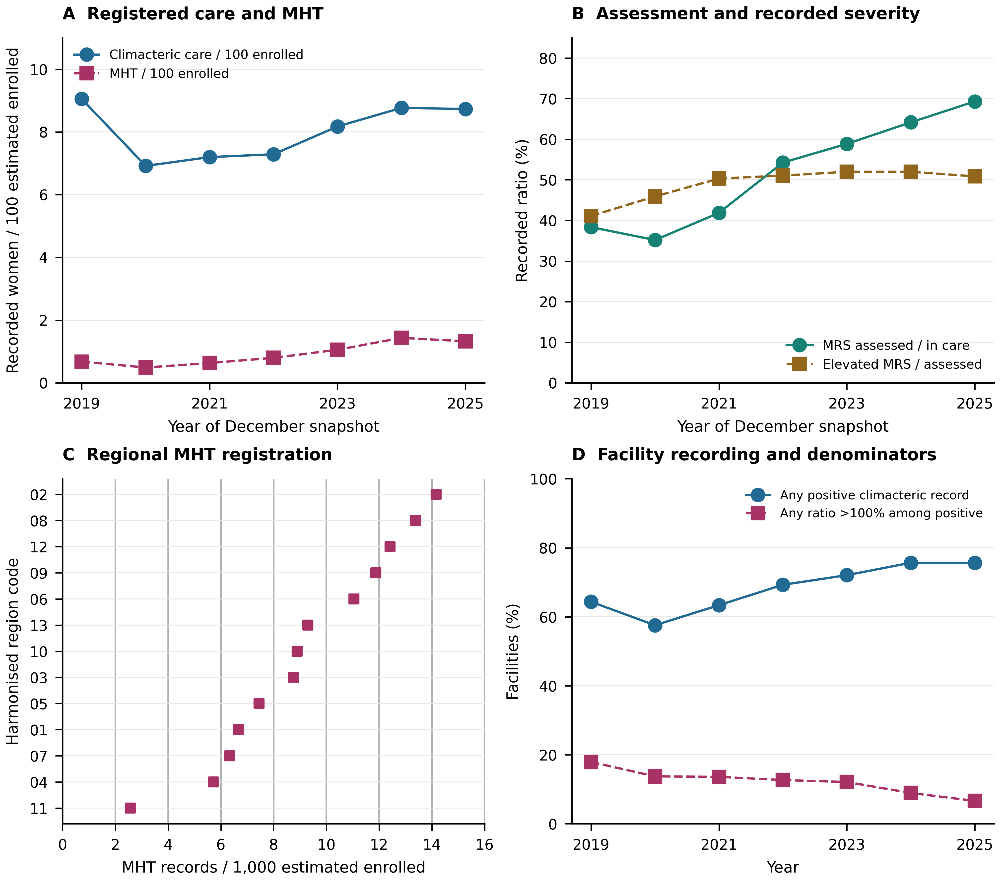</div></div>

<p class="interpretation-limit">MRS = Menopause Rating Scale. December records do not form a linked care cascade.</p>

<div class="source-footer">Sources: <a href="https://deis.minsal.cl/#datosabiertos">DEIS/MINSAL REM</a>, <a href="https://public.tableau.com/views/ReporteInscritosCentrosAPS/ReporteAPS?:showVizHome=no">FONASA APS enrolment</a>, <a href="https://www.ine.gob.cl/estadisticas-por-tema/demografia-y-poblacion/estimaciones-y-proyecciones-de-poblacion">INE base-2017 projections</a></div>

<div class="figure-link"><a href="../outputs/publication_programme_2026-10-28/paper3/Figure3_1_care_recording.png" target="_blank">Complete original figure</a></div>
```

::: {.notes}

Figure 8. Menopause-care indicators from December REM P1 records and estimated FONASA enrolment, 2019–2025. A: climacteric-care and MHT records per 100 estimated enrolled women aged 45–64, with separate labelled series on one scale. B: MRS-assessed women relative to recorded care and elevated MRS relative to assessed women. These are aggregate ratios and do not establish a linked clinical cascade. C: MHT counts in municipality-years with positive matching denominators, summed across December snapshots and divided by summed estimated enrolment within 13 harmonised regions; points are descriptive and no confidence intervals are shown. D: facilities with positive climacteric records among those with positive estimated enrolment, and facilities with at least one stage/enrolment ratio above 100% among those with positive records. The latter flags numerator–denominator inconsistency, not an audited error rate. Counts may repeat women across years. Denominators for ages 45–64 are prorated using municipal population age structure. Missing source cells cannot distinguish zero activity from absent reporting. The 2025 numerator layout and 2024 denominator age-band changes require explicit harmonisation checks before final longitudinal inference.

Original figure: outputs/publication_programme_2026-10-28/paper3/Figure3_1_care_recording.png. Panel windows preserve its data, scales and labels.

DEIS/MINSAL REM: https://deis.minsal.cl/#datosabiertos

FONASA APS enrolment: https://public.tableau.com/views/ReporteInscritosCentrosAPS/ReporteAPS?:showVizHome=no

INE base-2017 projections: https://www.ine.gob.cl/estadisticas-por-tema/demografia-y-poblacion/estimaciones-y-proyecciones-de-poblacion

:::

## Provider composition changes the rate comparison {#slide-22 .hero}

```{=html}
<div class="figure-area"><div class="panel-window" data-figure-key="care-extension-1" data-crop="[0, 0, 1, 0.49]" style="left:28.81011px;top:0.00000px;width:1094.37978px;height:470.00000px">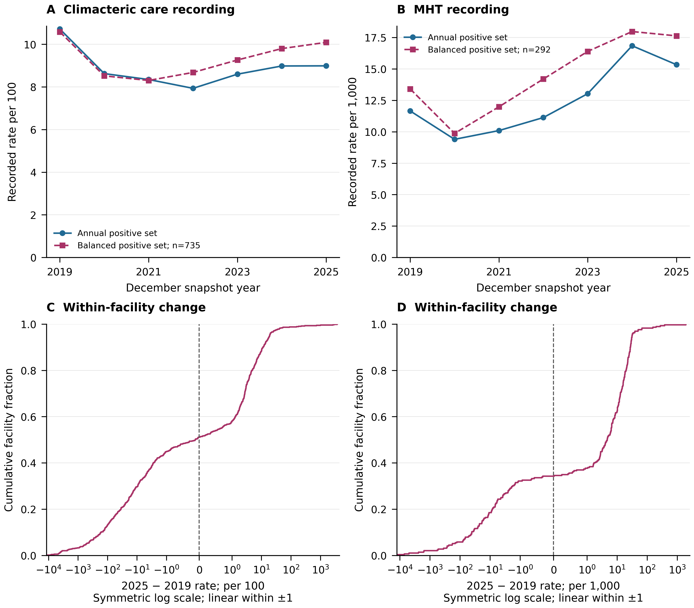</div></div>

<p class="interpretation-limit">Balanced positive-record panels remain selected provider populations.</p>

<div class="source-footer">Sources: <a href="https://deis.minsal.cl/#datosabiertos">DEIS/MINSAL REM</a>, <a href="https://public.tableau.com/views/ReporteInscritosCentrosAPS/ReporteAPS?:showVizHome=no">FONASA APS enrolment</a>, <a href="https://www.ine.gob.cl/estadisticas-por-tema/demografia-y-poblacion/estimaciones-y-proyecciones-de-poblacion">INE base-2017 projections</a></div>

<div class="figure-link"><a href="../outputs/publication_programme_2026-10-28/care_extension/care_balanced_panel.png" target="_blank">Complete original figure</a></div>
```

::: {.notes}

Figure 10. Annual recording and within-facility comparability sensitivity. A–B: stage-specific ratios of summed counts to summed positive same-year estimated enrolment in all annual positive-record facilities and in facilities with positive stage records and denominators in all seven December snapshots, 2019–2025. Balanced sets are selected on complete positive recording and differ by metric. C–D: empirical cumulative distributions of each balanced facility’s 2025 minus 2019 rate change. The horizontal scale is symmetric logarithmic outside the interval −1 to 1, which is linear; all observed changes are retained. Care uses records per 100 and MHT per 1,000 estimated enrolled women aged 45–64. No missing record is imputed as zero. Lines and distributions are descriptive; no uncertainty interval or causal trend is estimated. Numerator-layout and denominator age-band changes can affect temporal comparability.

Original figure: outputs/publication_programme_2026-10-28/care_extension/care_balanced_panel.png. Panel windows preserve its data, scales and labels.

DEIS/MINSAL REM: https://deis.minsal.cl/#datosabiertos

FONASA APS enrolment: https://public.tableau.com/views/ReporteInscritosCentrosAPS/ReporteAPS?:showVizHome=no

INE base-2017 projections: https://www.ine.gob.cl/estadisticas-por-tema/demografia-y-poblacion/estimaciones-y-proyecciones-de-poblacion

:::

## Local care recording varies across Santiago {#slide-23 .hero}

```{=html}
<div class="figure-area"><div class="panel-window" data-figure-key="base-4" data-crop="[0, 0.65, 1, 0.35]" style="left:0.00000px;top:9.64986px;width:1152.00000px;height:450.70027px">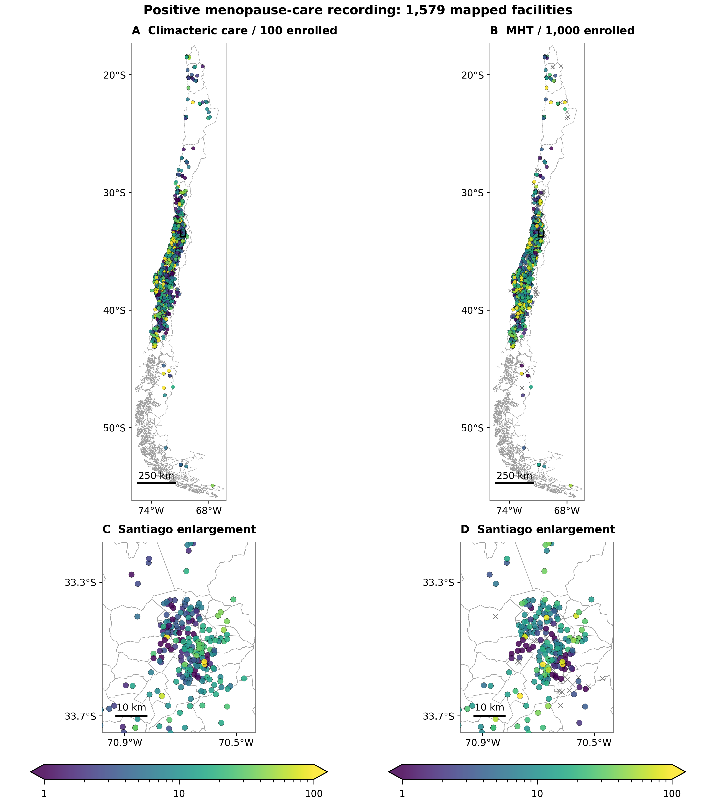</div></div>

<p class="interpretation-limit">Left: care/100; right: MHT/1,000. Crosses: no positive record; zero/missing unresolved.</p>

<div class="source-footer">Sources: <a href="https://deis.minsal.cl/#datosabiertos">DEIS/MINSAL REM</a>, <a href="https://public.tableau.com/views/ReporteInscritosCentrosAPS/ReporteAPS?:showVizHome=no">FONASA APS enrolment</a>, <a href="https://www.ine.gob.cl/estadisticas-por-tema/demografia-y-poblacion/estimaciones-y-proyecciones-de-poblacion">INE base-2017 projections</a>, <a href="https://www.bcn.cl/siit/siit/mapas_vectoriales/">BCN cartography</a></div>

<div class="figure-link"><a href="../outputs/publication_programme_2026-10-28/paper3/Figure3_2_care_geography.png" target="_blank">Complete original figure</a></div>
```

::: {.notes}

Figure 9. Facility geography of positive menopause-care recording in Chile, pooled December snapshots 2019–2025. A–B: recorded climacteric care per 100 and MHT per 1,000 estimated enrolled women aged 45–64. C–D: the same measures in the Santiago enlargement marked on the national maps. The 1,579 mapped facilities have any positive climacteric recording, at least 50 summed estimated enrolment observations and usable mainland coordinates; the map is not a census of eligible providers or a map of individual treatment uptake. Grey crosses denote facilities in this positive-record sample with no positive record for the particular mapped measure; derived files cannot separate confirmed zero from absent reporting. Colour scales are logarithmic from 1 to 100 in the distinct stated units; observations beyond the limits retain extreme colours. Numerators and denominators are first matched within facility-year with positive estimated enrolment, then summed; unmatched annual counts are excluded from mapped ratios and retained in the QC export. Women can recur across December snapshots. Age denominators are estimated from grouped FONASA enrolment using municipal INE age structure. WGS84 longitude and latitude are displayed with latitude-adjusted aspect ratios and approximate 250 km and 10 km scale bars. Oceanic and Antarctic territories are omitted. Spatial differences can reflect recording, selection and denominator construction as well as service provision; no new cluster tests or causal comparisons are made. Basemap boundaries: Biblioteca del Congreso Nacional de Chile, Mapoteca.

Original figure: outputs/publication_programme_2026-10-28/paper3/Figure3_2_care_geography.png. Panel windows preserve its data, scales and labels.

DEIS/MINSAL REM: https://deis.minsal.cl/#datosabiertos

FONASA APS enrolment: https://public.tableau.com/views/ReporteInscritosCentrosAPS/ReporteAPS?:showVizHome=no

INE base-2017 projections: https://www.ine.gob.cl/estadisticas-por-tema/demografia-y-poblacion/estimaciones-y-proyecciones-de-poblacion

BCN cartography: https://www.bcn.cl/siit/siit/mapas_vectoriales/

The complete original includes national maps A–B and is accessible from the image/Notes.

Cartography: Biblioteca del Congreso Nacional de Chile. Retained shapefile metadata identify BCN/SIIT2017. Project geometries are simplified and referential; the official vector-map catalogue requires BCN attribution.

:::

## The MHT sex contrast remains uncertain {#slide-24 .numeric-anchor}

```{=html}
<div class="table-area"><table data-table-id="lagged-mht"><colgroup><col style="width:19.097222%"><col style="width:26.041667%"><col style="width:54.861111%"></colgroup><thead><tr><th scope="col">Sex</th><th scope="col">Respondents, n</th><th scope="col">Adjusted OR (95% CI)</th></tr></thead><tbody><tr><td>Women</td><td>12949</td><td>0.920 (0.851–0.994)</td></tr><tr><td>Men</td><td>10379</td><td>0.963 (0.879–1.054)</td></tr></tbody></table></div>

<div class="headline-stat"><strong>p = 0.428</strong><span>MHT-by-sex interaction test<br>CASEN, age 60–69, FONASA</span></div>

<p class="selection-label">Any reported difficulty; municipal MHT, 2019–2023. Both sex rows shown.</p>

<p class="interpretation-limit">OR per 10 MHT records/1,000 estimated enrolled women. Contextual recording does not identify individual treatment.</p>

<div class="source-footer">Sources: <a href="https://observatorio.ministeriodesarrollosocial.gob.cl/encuesta-casen-2024">CASEN 2024 (MDSF)</a>, <a href="https://deis.minsal.cl/#datosabiertos">DEIS/MINSAL REM</a>, <a href="https://public.tableau.com/views/ReporteInscritosCentrosAPS/ReporteAPS?:showVizHome=no">FONASA APS enrolment</a>, <a href="https://observatorio.ministeriodesarrollosocial.gob.cl/pobreza-comunal-2024">SAE 2024 (MDSF)</a></div>

<div class="figure-link">Table 23</div>
```

::: {.notes}

Re-estimated CASEN contextual MHT models

Municipal exposure per 10 additional MHT records per 1,000 estimated enrolled women; individual any-difficulty outcome. Full-design results are kept separate from the inherited MRS models. Exposure matching and causal interpretation remain unresolved even after survey covariance repair.

2 of 2 source rows shown; all 3 selected columns kept exactly

CASEN 2024 (MDSF): https://observatorio.ministeriodesarrollosocial.gob.cl/encuesta-casen-2024

DEIS/MINSAL REM: https://deis.minsal.cl/#datosabiertos

FONASA APS enrolment: https://public.tableau.com/views/ReporteInscritosCentrosAPS/ReporteAPS?:showVizHome=no

SAE 2024 (MDSF): https://observatorio.ministeriodesarrollosocial.gob.cl/pobreza-comunal-2024

:::

## Later neurological registration remains exploratory {#slide-25 .hero}

```{=html}
<div class="figure-area"><div class="panel-window" data-figure-key="base-5" data-crop="[0, 0, 1, 1]" style="left:136.94695px;top:0.00000px;width:878.10610px;height:470.00000px">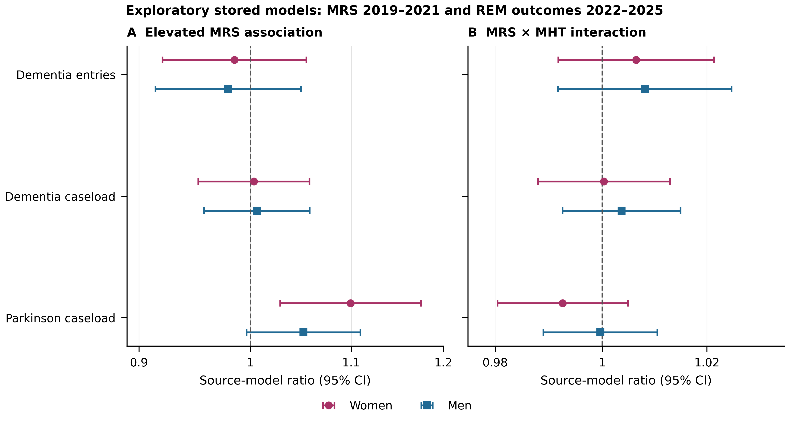</div></div>

<p class="interpretation-limit">Inherited facility models; nominal intervals and different exposure/outcome cohorts.</p>

<div class="source-footer">Sources: <a href="https://deis.minsal.cl/#datosabiertos">DEIS/MINSAL REM</a>, <a href="https://public.tableau.com/views/ReporteInscritosCentrosAPS/ReporteAPS?:showVizHome=no">FONASA APS enrolment</a></div>

<div class="figure-link"><a href="../outputs/publication_programme_2026-10-28/figures/Figure5_contextual_neurodegeneration.png" target="_blank">Complete original figure</a></div>
```

::: {.notes}

Figure 14. Stored exploratory facility-level MRS and later neurodegenerative registration models. A: source Poisson ratios for a 10 percentage-point higher proportion of elevated MRS among assessed women during 2019–2021, conditional on the model’s centered MHT ratio. B: multiplicative MRS×MHT interaction terms, where MRS is scaled per 10 percentage points and MHT per 10 users per 100 elevated-MRS records. Outcomes are dementia entries, repeated December dementia caseload and repeated December Parkinson caseload at ages ≥60 in 2022–2025. Both recorded sexes are displayed for all three outcomes. Models use expected-count offsets, source covariates, municipal fixed effects and municipality-clustered standard errors; retained samples differ by sex and outcome. Points and 95% intervals reproduce mf18 saved results and have not been independently refitted in this report. Intervals are not corrected for the wider analysis family. Exposure and outcome populations need not contain the same individuals or cohorts. Associations reflect registration and selected facility populations as well as possible clinical variation; they do not estimate individual hormone effects or demonstrate causal moderation.

Original figure: outputs/publication_programme_2026-10-28/figures/Figure5_contextual_neurodegeneration.png. Panel windows preserve its data, scales and labels.

DEIS/MINSAL REM: https://deis.minsal.cl/#datosabiertos

FONASA APS enrolment: https://public.tableau.com/views/ReporteInscritosCentrosAPS/ReporteAPS?:showVizHome=no

:::

## The combined evidence supports distinct levels of inference {#slide-26 .statement}

```{=html}
<div class="text-area"><p>Recorded neurodegenerative patterns depend on age, diagnostic coding and the observation source.</p><p>Reproductive histories show symptom associations. Surgery records still lack an informative subsequent-disease link.</p><p>Care records show programme and geographic variation, with denominator and reporting limits.</p></div>

<p class="selection-label">Proposed next: menopausal-care access and neurological diagnostic-recording studies.</p>

<p class="interpretation-limit">The combined evidence does not establish individual hormonal protection.</p>

<div class="source-footer">Sources: <a href="https://deis.minsal.cl/#datosabiertos">DEIS mortality</a>, <a href="https://public.tableau.com/views/PropuestaTableroGRD/PropuestaTableroGRD?:showVizHome=no">FONASA GRD</a>, <a href="https://observatorio.ministeriodesarrollosocial.gob.cl/encuesta-casen-2024">CASEN 2024 (MDSF)</a>, <a href="https://deis.minsal.cl/#datosabiertos">DEIS/MINSAL REM</a></div>
```

::: {.notes}

DEIS mortality: https://deis.minsal.cl/#datosabiertos

FONASA GRD: https://public.tableau.com/views/PropuestaTableroGRD/PropuestaTableroGRD?:showVizHome=no

CASEN 2024 (MDSF): https://observatorio.ministeriodesarrollosocial.gob.cl/encuesta-casen-2024

DEIS/MINSAL REM: https://deis.minsal.cl/#datosabiertos

:::

## Proposed research after the current analyses {#slide-27 .statement}

```{=html}
<div class="text-area"><p>Menopausal care: validate programme denominators and examine contact, satisfaction and affordability when measured.</p><p>Neurological recording: examine diagnostic coding and co-occurrence using each source’s observation unit.</p><p>Associations: repair remaining survey variance and seek longer follow-up with compatible exposure and disease linkage.</p></div>

<p class="interpretation-limit">Proposed only. These analyses have not been completed and add no new results.</p>

<div class="source-footer">Sources: <a href="https://deis.minsal.cl/#datosabiertos">DEIS/MINSAL REM</a>, <a href="https://public.tableau.com/views/ReporteInscritosCentrosAPS/ReporteAPS?:showVizHome=no">FONASA APS enrolment</a>, <a href="https://observatorio.ministeriodesarrollosocial.gob.cl/encuesta-casen-2024">CASEN 2024 (MDSF)</a>, <a href="https://public.tableau.com/views/PropuestaTableroGRD/PropuestaTableroGRD?:showVizHome=no">FONASA GRD</a></div>
```

::: {.notes}

DEIS/MINSAL REM: https://deis.minsal.cl/#datosabiertos

FONASA APS enrolment: https://public.tableau.com/views/ReporteInscritosCentrosAPS/ReporteAPS?:showVizHome=no

CASEN 2024 (MDSF): https://observatorio.ministeriodesarrollosocial.gob.cl/encuesta-casen-2024

FONASA GRD: https://public.tableau.com/views/PropuestaTableroGRD/PropuestaTableroGRD?:showVizHome=no

Proposed framework: docs/access_diagnostic_recording_extension.html. This is a future programme, not a completed analysis or newly fitted result.

:::

## Original data and methodological sources {#slide-28 .references}

```{=html}
<div class="reference-groups"><div><h3>National routine records</h3><p><a href="https://deis.minsal.cl/#datosabiertos">DEIS mortality</a></p><p><a href="https://deis.minsal.cl/#datosabiertos">DEIS hospital discharges</a></p><p><a href="https://public.tableau.com/views/PropuestaTableroGRD/PropuestaTableroGRD?:showVizHome=no">FONASA GRD</a></p></div><div><h3>Primary care</h3><p><a href="https://deis.minsal.cl/#datosabiertos">DEIS/MINSAL REM</a></p><p><a href="https://deis.minsal.cl/faqs/">DEIS REM definitions</a></p><p><a href="https://repositoriodeis.minsal.cl/ContenidoSitioWeb2020/REM/2025/SERIE/MANUAL_REM_P_2025_Version_1.2.pdf">REM Series P manual</a></p><p><a href="https://public.tableau.com/views/ReporteInscritosCentrosAPS/ReporteAPS?:showVizHome=no">FONASA APS enrolment</a></p></div><div><h3>National and local denominators</h3><p><a href="https://www.ine.gob.cl/estadisticas-por-tema/demografia-y-poblacion/estimaciones-y-proyecciones-de-poblacion">INE national base-2024</a></p><p><a href="https://www.ine.gob.cl/estadisticas-por-tema/demografia-y-poblacion/estimaciones-y-proyecciones-de-poblacion">INE base-2017 projections</a></p><p><a href="https://www.bcn.cl/siit/siit/mapas_vectoriales/">BCN cartography</a></p></div></div>

<div class="editable-source-links"><a href="combined_project_key_results_slides_source.txt" download="combined_project_key_results_slides.qmd">Editable QMD</a> · <a href="combined_project_slides_references.bib">Original references</a></div>

<p class="interpretation-limit">Numerical findings are the authors’ calculations from the retained, reviewed study extracts.</p>
```

::: {.notes}

DEIS mortality: https://deis.minsal.cl/#datosabiertos

DEIS hospital discharges: https://deis.minsal.cl/#datosabiertos

FONASA GRD: https://public.tableau.com/views/PropuestaTableroGRD/PropuestaTableroGRD?:showVizHome=no

DEIS/MINSAL REM: https://deis.minsal.cl/#datosabiertos

DEIS REM definitions: https://deis.minsal.cl/faqs/

REM Series P manual: https://repositoriodeis.minsal.cl/ContenidoSitioWeb2020/REM/2025/SERIE/MANUAL_REM_P_2025_Version_1.2.pdf

FONASA APS enrolment: https://public.tableau.com/views/ReporteInscritosCentrosAPS/ReporteAPS?:showVizHome=no

INE national base-2024: https://www.ine.gob.cl/estadisticas-por-tema/demografia-y-poblacion/estimaciones-y-proyecciones-de-poblacion

INE base-2017 projections: https://www.ine.gob.cl/estadisticas-por-tema/demografia-y-poblacion/estimaciones-y-proyecciones-de-poblacion

BCN cartography: https://www.bcn.cl/siit/siit/mapas_vectoriales/

:::

## Original data and methodological sources: surveys and context {#slide-29 .references}

```{=html}
<div class="reference-groups"><div><h3>Population surveys</h3><p><a href="https://observatorio.ministeriodesarrollosocial.gob.cl/encuesta-casen-2024">CASEN 2024 (MDSF)</a></p><p><a href="https://observatorio.ministeriodesarrollosocial.gob.cl/storage/docs/casen/2024/Nota_uso_bases_de_datos_Casen_2024.pdf">CASEN database guide</a></p></div><div><h3>ENCAVI documentation</h3><p><a href="https://epi.minsal.cl/wp-content/uploads/2025/08/Informe_metodologico_ENCAVI_2023_2024.pdf">ENCAVI methodology (MINSAL)</a></p><p><a href="https://epi.minsal.cl/wp-content/uploads/2025/08/Manual_de_base_de_datos_ENCAVI_2023_2024.pdf">ENCAVI data manual (MINSAL)</a></p></div><div><h3>Territorial context</h3><p><a href="https://www.ine.gob.cl/docs/default-source/proyecciones-de-poblacion/metodologia/proyecci%C3%B3n-base-2017/estimaciones-y-proyecciones-2002-2035-comunas-y-%C3%A1rea-metodolog%C3%ADa.pdf?sfvrsn=71c4ebf1_4">INE urban/rural methodology</a></p><p><a href="https://observatorio.ministeriodesarrollosocial.gob.cl/pobreza-comunal-2024">SAE 2024 (MDSF)</a></p></div></div>

<div class="editable-source-links"><a href="combined_project_key_results_slides_source.txt" download="combined_project_key_results_slides.qmd">Editable QMD</a> · <a href="combined_project_slides_references.bib">Original references</a></div>

<p class="interpretation-limit">Numerical findings are the authors’ calculations from the retained, reviewed study extracts.</p>
```

::: {.notes}

CASEN 2024 (MDSF): https://observatorio.ministeriodesarrollosocial.gob.cl/encuesta-casen-2024

CASEN database guide: https://observatorio.ministeriodesarrollosocial.gob.cl/storage/docs/casen/2024/Nota_uso_bases_de_datos_Casen_2024.pdf

ENCAVI methodology (MINSAL): https://epi.minsal.cl/wp-content/uploads/2025/08/Informe_metodologico_ENCAVI_2023_2024.pdf

ENCAVI data manual (MINSAL): https://epi.minsal.cl/wp-content/uploads/2025/08/Manual_de_base_de_datos_ENCAVI_2023_2024.pdf

INE urban/rural methodology: https://www.ine.gob.cl/docs/default-source/proyecciones-de-poblacion/metodologia/proyecci%C3%B3n-base-2017/estimaciones-y-proyecciones-2002-2035-comunas-y-%C3%A1rea-metodolog%C3%ADa.pdf?sfvrsn=71c4ebf1_4

SAE 2024 (MDSF): https://observatorio.ministeriodesarrollosocial.gob.cl/pobreza-comunal-2024

:::
