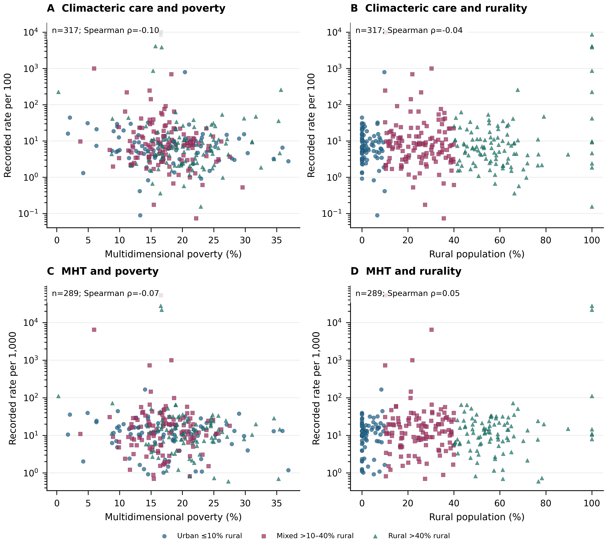

## Reproductive factors and cognitive health in Chile {#slide-1 .cover}

```{=html}
<div class="text-area"><p>Family history, ovarian surgery and care context</p></div>

<p class="interpretation-limit">Reported symptoms and registered neurological disease are distinct outcomes.</p>

<div class="source-footer">Sources: <a href="https://observatorio.ministeriodesarrollosocial.gob.cl/encuesta-casen-2024">CASEN 2024 (MDSF)</a>, <a href="https://public.tableau.com/views/PropuestaTableroGRD/PropuestaTableroGRD?:showVizHome=no">FONASA GRD</a>, <a href="https://deis.minsal.cl/#datosabiertos">DEIS/MINSAL REM</a>, <a href="https://public.tableau.com/views/ReporteInscritosCentrosAPS/ReporteAPS?:showVizHome=no">FONASA APS enrolment</a></div>
```

::: {.notes}

CASEN 2024 (MDSF): https://observatorio.ministeriodesarrollosocial.gob.cl/encuesta-casen-2024

FONASA GRD: https://public.tableau.com/views/PropuestaTableroGRD/PropuestaTableroGRD?:showVizHome=no

DEIS/MINSAL REM: https://deis.minsal.cl/#datosabiertos

FONASA APS enrolment: https://public.tableau.com/views/ReporteInscritosCentrosAPS/ReporteAPS?:showVizHome=no

:::

## Symptoms, procedures and registrations {#slide-2 .statement}

```{=html}
<div class="text-area"><p>Surveys measure individual family histories and reported difficulties.</p><p>GRD records surgery; BSO is the configured bilateral/remaining-ovary removal flag.</p><p>REM/FONASA record care, menopausal hormone therapy (MHT) and estimated enrolment.</p></div>

<p class="interpretation-limit">The sources do not constitute one linked longitudinal cohort.</p>

<div class="source-footer">Sources: <a href="https://observatorio.ministeriodesarrollosocial.gob.cl/encuesta-casen-2024">CASEN 2024 (MDSF)</a>, <a href="https://epi.minsal.cl/wp-content/uploads/2025/08/Informe_metodologico_ENCAVI_2023_2024.pdf">ENCAVI methodology (MINSAL)</a>, <a href="https://epi.minsal.cl/wp-content/uploads/2025/08/Manual_de_base_de_datos_ENCAVI_2023_2024.pdf">ENCAVI data manual (MINSAL)</a>, <a href="https://public.tableau.com/views/PropuestaTableroGRD/PropuestaTableroGRD?:showVizHome=no">FONASA GRD</a>, <a href="https://deis.minsal.cl/#datosabiertos">DEIS/MINSAL REM</a>, <a href="https://public.tableau.com/views/ReporteInscritosCentrosAPS/ReporteAPS?:showVizHome=no">FONASA APS enrolment</a></div>
```

::: {.notes}

CASEN 2024 (MDSF): https://observatorio.ministeriodesarrollosocial.gob.cl/encuesta-casen-2024

ENCAVI methodology (MINSAL): https://epi.minsal.cl/wp-content/uploads/2025/08/Informe_metodologico_ENCAVI_2023_2024.pdf

ENCAVI data manual (MINSAL): https://epi.minsal.cl/wp-content/uploads/2025/08/Manual_de_base_de_datos_ENCAVI_2023_2024.pdf

FONASA GRD: https://public.tableau.com/views/PropuestaTableroGRD/PropuestaTableroGRD?:showVizHome=no

DEIS/MINSAL REM: https://deis.minsal.cl/#datosabiertos

FONASA APS enrolment: https://public.tableau.com/views/ReporteInscritosCentrosAPS/ReporteAPS?:showVizHome=no

:::

## Family history associations differ by sex {#slide-3 .hero}

```{=html}
<div class="figure-area"><div class="panel-window" data-figure-key="base-1" data-crop="[0, 0, 1, 1]" style="left:99.73087px;top:0.00000px;width:952.53827px;height:465.00000px"></div></div>

<p class="interpretation-limit">Reported difficulty, age ≥60; adjusted associations with validated survey uncertainty.</p>

<div class="source-footer">Sources: <a href="https://observatorio.ministeriodesarrollosocial.gob.cl/encuesta-casen-2024">CASEN 2024 (MDSF)</a></div>

<div class="figure-link"><a href="reproductive_life_course.html#figure-1">Full Figure 1 and caption</a></div>
```

::: {.notes}

Figure 1. Number of reported live-born children and any self-reported remembering or concentrating difficulty in CASEN 2024 respondents aged 60 years or older. A: women; B: men. Two children is the reference. Points are weighted logistic odds ratios adjusted for age group, schooling, rural residence, harmonised region, FONASA status and indigenous identification. Intervals use full-frame survey linearisation and R survey domain-model residual degrees of freedom; coefficients and standard errors were independently reproduced in Python and R. All four displayed contrasts per sex are retained. The joint parity-by-sex F test evaluates the four interactions together and does not imply that each individual contrast differs by sex. These are cross-sectional associations in complete-case respondents, not dementia diagnoses, cognitive decline or effects of pregnancy or hormones. The odds ratio is not a prevalence ratio. No participant linkage to GRD surgery or REM treatment records is available.

Original figure: outputs/publication_programme_2026-10-28/figures/Figure1_reproductive_history.png. Panel windows preserve its data, scales and labels.

CASEN 2024 (MDSF): https://observatorio.ministeriodesarrollosocial.gob.cl/encuesta-casen-2024

:::

## Reported difficulty rises across older age groups {#slide-4 .hero}

```{=html}
<div class="figure-area"><div class="panel-window" data-figure-key="survey-extension-1" data-crop="[0, 0, 1, 0.5]" style="left:7.32044px;top:0.00000px;width:1137.35912px;height:465.00000px"></div></div>

<p class="interpretation-limit">Selected analytic sample; saved weighted points have no recoverable design CIs.</p>

<div class="source-footer">Sources: <a href="https://observatorio.ministeriodesarrollosocial.gob.cl/encuesta-casen-2024">CASEN 2024 (MDSF)</a></div>

<div class="figure-link"><a href="reproductive_life_course.html#figure-2">Full Figure 2 and caption</a></div>
```

::: {.notes}

Figure 2. Age-specific weighted remembering/concentrating difficulty in the saved reproductive-history analytic samples. Panels A–B show CASEN 2024 and C–D ENCAVI 2023–2024; any and severe outcomes use separate labelled y scales, common within each outcome across instruments. Sex is encoded by colour and marker/line pattern. Values are weighted point estimates only; the saved source lacks design variances, so confidence intervals are unavailable. Lines join observed age-group summaries and do not represent longitudinal trajectories. CASEN severe means categories 3–4 and ENCAVI severe categories 4–5. ENCAVI uses a different health-related item and has an unresolved target-coverage/calibration conflict; between-instrument differences are not interpreted as disease differences.

Original figure: outputs/publication_programme_2026-10-28/survey_extension/figures/survey_age_profiles.png. Panel windows preserve its data, scales and labels.

CASEN 2024 (MDSF): https://observatorio.ministeriodesarrollosocial.gob.cl/encuesta-casen-2024

:::

## Severe difficulty models remain provisional {#slide-5 .hero}

```{=html}
<div class="figure-area"><div class="panel-window" data-figure-key="survey-extension-2" data-crop="[0, 0.49, 1, 0.46]" style="left:27.05116px;top:37.20000px;width:1097.89768px;height:427.80000px"></div><div class="panel-legend" style="left:230.4px;top:0px;width:691.1999999999999px;height:37.2px"><span><span style="color:#A05A17">●</span> Age only</span><span><span style="color:#216A94">■</span> Full adjustment</span></div></div>

<p class="interpretation-limit">CASEN categories 3–4; inherited nominal intervals still need domain repair.</p>

<div class="source-footer">Sources: <a href="https://observatorio.ministeriodesarrollosocial.gob.cl/encuesta-casen-2024">CASEN 2024 (MDSF)</a></div>

<div class="figure-link"><a href="reproductive_life_course.html#figure-3">Full Figure 3 and caption</a></div>
```

::: {.notes}

Figure 3. CASEN 2024 child-number associations with any and severe self-reported difficulty, retaining every contrast versus two children in women and men aged 60 or older. Panels A–B show any difficulty and C–D severe difficulty. Orange circles show age-only and blue squares fully adjusted logistic odds ratios with available nominal 95% intervals. Fully adjusted any-difficulty intervals are the independently validated R survey t intervals; age-only and severe intervals remain inherited normal intervals with domain repair pending. The horizontal axis is logarithmic. Adjustment can change both the covariate set and the analytic sample; shifts are descriptive and do not identify confounding removal or mediation. Severe means categories 3–4. These outcomes are not diagnosed dementia or cognitive decline.

Original figure: outputs/publication_programme_2026-10-28/survey_extension/figures/survey_casen_adjustment.png. Panel windows preserve its data, scales and labels.

CASEN 2024 (MDSF): https://observatorio.ministeriodesarrollosocial.gob.cl/encuesta-casen-2024

:::

## ENCAVI uses a different symptom scale {#slide-6 .hero}

```{=html}
<div class="figure-area"><div class="panel-window" data-figure-key="survey-extension-3" data-crop="[0, 0.49, 1, 0.46]" style="left:27.05116px;top:37.20000px;width:1097.89768px;height:427.80000px"></div><div class="panel-legend" style="left:230.4px;top:0px;width:691.1999999999999px;height:37.2px"><span><span style="color:#A05A17">●</span> Age only</span><span><span style="color:#216A94">■</span> Full adjustment</span></div></div>

<p class="interpretation-limit">Severe 4–5; inherited CIs. Coverage/calibration of the prepared sample remain unresolved.</p>

<div class="source-footer">Sources: <a href="https://epi.minsal.cl/wp-content/uploads/2025/08/Informe_metodologico_ENCAVI_2023_2024.pdf">ENCAVI methodology (MINSAL)</a>, <a href="https://epi.minsal.cl/wp-content/uploads/2025/08/Manual_de_base_de_datos_ENCAVI_2023_2024.pdf">ENCAVI data manual (MINSAL)</a></div>

<div class="figure-link"><a href="reproductive_life_course.html#figure-4">Full Figure 4 and caption</a></div>
```

::: {.notes}

Figure 4. ENCAVI 2023–2024 analysed as a separate instrument: all stored child-number contrasts versus two children for any and severe health-related remembering/concentrating difficulty in prepared ENCAVI respondents aged 60 or older. Any means categories 2–5; severe means 4–5. Orange circles show age-only and blue squares age/education/region-adjusted odds ratios. The logarithmic axis retains all nominal 95% source intervals, including wide intervals; full-domain variance repair has not been executed because the external person files are unavailable. This survey asks whether/how many children respondents have rather than explicit lifetime live births. The panels cannot establish direct replication, absence of association or equivalence with CASEN.

Original figure: outputs/publication_programme_2026-10-28/survey_extension/figures/survey_encavi_separate.png. Panel windows preserve its data, scales and labels.

ENCAVI methodology (MINSAL): https://epi.minsal.cl/wp-content/uploads/2025/08/Informe_metodologico_ENCAVI_2023_2024.pdf

ENCAVI data manual (MINSAL): https://epi.minsal.cl/wp-content/uploads/2025/08/Manual_de_base_de_datos_ENCAVI_2023_2024.pdf

:::

## Procedure records overlap and repeat people {#slide-7 .hero}

```{=html}
<div class="figure-area"><div class="panel-window" data-figure-key="surgery-extension-1" data-crop="[0, 0, 1, 0.435]" style="left:0.00000px;top:5.52946px;width:1152.00000px;height:453.94108px"></div></div>

<p class="interpretation-limit">Public GRD, 2019–2024; recorded activity is not national incidence.</p>

<div class="source-footer">Sources: <a href="https://public.tableau.com/views/PropuestaTableroGRD/PropuestaTableroGRD?:showVizHome=no">FONASA GRD</a></div>

<div class="figure-link"><a href="reproductive_life_course.html#figure-6">Full Figure 6 and caption</a></div>
```

::: {.notes}

Figure 6. Procedure-coded activity and case composition in public-hospital GRD file years 2019–2024. A: annual episodes with hysterectomy, combined BSO or unilateral flags; the groups overlap. B: distribution across five-year age bands among episodes aged at least 20, expressed within each procedure group; curves are composition, not population incidence. C: annual hierarchical diagnosis composition among BSO-coded episodes below 46, including the small number below age 20; categories are mutually exclusive under the stated any-position hierarchy. D: hospital versus ambulatory/other activity among all BSO-coded episodes, across all ages and indications. The combined BSO flag merges both-ovary and remaining-ovary codes. No menopause, clinical appropriateness, provider performance or causal interpretation is assigned. These are descriptive recorded counts without stochastic intervals.

Original figure: outputs/publication_programme_2026-10-28/surgery_extension/figures/surgery_extension_activity_composition.png. Panel windows preserve its data, scales and labels.

FONASA GRD: https://public.tableau.com/views/PropuestaTableroGRD/PropuestaTableroGRD?:showVizHome=no

:::

## BSO coding in the primary adult denominator {#slide-8 .numeric-anchor}

```{=html}
<div class="table-area"><table data-table-id="surgery-age-table"><colgroup><col style="width:15.190972%"><col style="width:21.267361%"><col style="width:19.097222%"><col style="width:12.152778%"><col style="width:32.291667%"></colgroup><thead><tr><th scope="col">Age at admission</th><th scope="col">Hysterectomy episodes</th><th scope="col">Same-episode BSO</th><th scope="col">BSO %</th><th scope="col">Wilson 95% reference interval</th></tr></thead><tbody><tr><td>20–39</td><td>4164</td><td>260</td><td>6.24</td><td>5.55–7.02</td></tr><tr><td>40–45</td><td>10648</td><td>863</td><td>8.10</td><td>7.60–8.64</td></tr></tbody></table></div>

<div class="headline-stat"><strong>7.58%</strong><span>1,123 of 14,812 specified-benign hysterectomy episodes, ages 20–45</span></div>

<p class="selection-label">Primary adult age rows; 2 of 5 age rows shown</p>

<p class="interpretation-limit">Specified-benign diagnoses, age 20–45; coding does not establish operative indication.</p>

<div class="source-footer">Sources: <a href="https://public.tableau.com/views/PropuestaTableroGRD/PropuestaTableroGRD?:showVizHome=no">FONASA GRD</a></div>

<div class="figure-link">Table 10 excerpt</div>
```

::: {.notes}

Same-episode BSO among specified-benign hysterectomy episodes by adult age

Pooled 2019–2024. Age is the floored inherited admission-age proxy; menopausal status is unavailable. All groups use the specified-benign hierarchy, excluding higher-priority cancer/risk categories and other/unspecified. Unadjusted Wilson intervals assume independent episodes and do not include provider clustering or coding uncertainty.

2 of 5 source rows shown; all 5 selected columns kept exactly

FONASA GRD: https://public.tableau.com/views/PropuestaTableroGRD/PropuestaTableroGRD?:showVizHome=no

:::

## Diagnosis definitions change the observed proportion {#slide-9 .hero}

```{=html}
<div class="figure-area"><div class="panel-window" data-figure-key="surgery-extension-2" data-crop="[0.465, 0, 0.535, 0.5]" style="left:301.36936px;top:0.00000px;width:549.26127px;height:465.00000px"></div></div>

<p class="interpretation-limit">Panel B includes all ages; BSO flags also include removal of a remaining ovary.</p>

<div class="source-footer">Sources: <a href="https://public.tableau.com/views/PropuestaTableroGRD/PropuestaTableroGRD?:showVizHome=no">FONASA GRD</a></div>

<div class="figure-link"><a href="reproductive_life_course.html#figure-7">Full Figure 7 and caption</a></div>
```

::: {.notes}

Figure 7. Denominator and observation-unit sensitivities for BSO coding at hysterectomy. A: pooled 2019–2024 specified-benign episodes at adult ages, with the exact numerators and denominators in the accompanying age table. B: all-age 2019–2024 hysterectomy episodes under each mutually exclusive diagnosis hierarchy category; this population differs from A. C: specified-benign episodes restricted to adult age ranges 20–44, 20–45 and 20–49; changing the upper age changes case mix. D: all eligible age 20–45 episodes in GRD file years 2021–2024 versus the first observed eligible episode per valid person identifier in those file years. Counts with missing identifiers are excluded only from the person sensitivity. Whiskers are unadjusted Wilson 95% binomial reference intervals; episode intervals assume independent episodes, and none includes provider clustering or coding/selection uncertainty. The comparison does not establish equivalence or effects of age, surgery or clinical care. No BSO code does not confirm preserved ovarian tissue; the BSO flag includes remaining-ovary removal.

Original figure: outputs/publication_programme_2026-10-28/surgery_extension/figures/surgery_extension_denominator_sensitivity.png. Panel windows preserve its data, scales and labels.

FONASA GRD: https://public.tableau.com/views/PropuestaTableroGRD/PropuestaTableroGRD?:showVizHome=no

:::

## No subsequent neurological admission was recorded {#slide-10 .metric}

```{=html}
<div class="metric-area"><strong>0</strong><p>later-admission dementia or Parkinson-related records</p></div>

<div class="metric-context"><p>774 people with BSO coding; 9,755 without a BSO code.</p><p>First eligible observed hysterectomy in comparable GRD file years 2021–2024.</p></div>

<p class="interpretation-limit">Short, incomplete capture prevents an effect or safety comparison.</p>

<div class="source-footer">Sources: <a href="https://public.tableau.com/views/PropuestaTableroGRD/PropuestaTableroGRD?:showVizHome=no">FONASA GRD</a></div>
```

::: {.notes}

FONASA GRD: https://public.tableau.com/views/PropuestaTableroGRD/PropuestaTableroGRD?:showVizHome=no

:::

## MHT recording increased during 2019–2025 {#slide-11 .hero}

```{=html}
<div class="figure-area"><div class="panel-window" data-figure-key="base-3" data-crop="[0, 0, 1, 0.5]" style="left:49.05250px;top:0.00000px;width:1053.89500px;height:465.00000px"></div></div>

<p class="interpretation-limit">MRS = Menopause Rating Scale. December records do not form a linked care cascade.</p>

<div class="source-footer">Sources: <a href="https://deis.minsal.cl/#datosabiertos">DEIS/MINSAL REM</a>, <a href="https://public.tableau.com/views/ReporteInscritosCentrosAPS/ReporteAPS?:showVizHome=no">FONASA APS enrolment</a>, <a href="https://www.ine.gob.cl/estadisticas-por-tema/demografia-y-poblacion/estimaciones-y-proyecciones-de-poblacion">INE base-2017 projections</a></div>

<div class="figure-link"><a href="reproductive_life_course.html#figure-8">Full Figure 8 and caption</a></div>
```

::: {.notes}

Figure 8. Menopause-care indicators from December REM P1 records and estimated FONASA enrolment, 2019–2025. A: climacteric-care and MHT records per 100 estimated enrolled women aged 45–64, with separate labelled series on one scale. B: MRS-assessed women relative to recorded care and elevated MRS relative to assessed women. These are aggregate ratios and do not establish a linked clinical cascade. C: MHT counts in municipality-years with positive matching denominators, summed across December snapshots and divided by summed estimated enrolment within 13 harmonised regions; points are descriptive and no confidence intervals are shown. D: facilities with positive climacteric records among those with positive estimated enrolment, and facilities with at least one stage/enrolment ratio above 100% among those with positive records. The latter flags numerator–denominator inconsistency, not an audited error rate. Counts may repeat women across years. Denominators for ages 45–64 are prorated using municipal population age structure. Missing source cells cannot distinguish zero activity from absent reporting. The 2025 numerator layout and 2024 denominator age-band changes require explicit harmonisation checks before final longitudinal inference.

Original figure: outputs/publication_programme_2026-10-28/paper3/Figure3_1_care_recording.png. Panel windows preserve its data, scales and labels.

DEIS/MINSAL REM: https://deis.minsal.cl/#datosabiertos

FONASA APS enrolment: https://public.tableau.com/views/ReporteInscritosCentrosAPS/ReporteAPS?:showVizHome=no

INE base-2017 projections: https://www.ine.gob.cl/estadisticas-por-tema/demografia-y-poblacion/estimaciones-y-proyecciones-de-poblacion

:::

## Provider composition changes the rate comparison {#slide-12 .hero}

```{=html}
<div class="figure-area"><div class="panel-window" data-figure-key="care-extension-1" data-crop="[0, 0, 1, 0.49]" style="left:34.63128px;top:0.00000px;width:1082.73744px;height:465.00000px"></div></div>

<p class="interpretation-limit">Balanced positive-record panels remain selected provider populations.</p>

<div class="source-footer">Sources: <a href="https://deis.minsal.cl/#datosabiertos">DEIS/MINSAL REM</a>, <a href="https://public.tableau.com/views/ReporteInscritosCentrosAPS/ReporteAPS?:showVizHome=no">FONASA APS enrolment</a>, <a href="https://www.ine.gob.cl/estadisticas-por-tema/demografia-y-poblacion/estimaciones-y-proyecciones-de-poblacion">INE base-2017 projections</a></div>

<div class="figure-link"><a href="reproductive_life_course.html#figure-10">Full Figure 10 and caption</a></div>
```

::: {.notes}

Figure 10. Annual recording and within-facility comparability sensitivity. A–B: stage-specific ratios of summed counts to summed positive same-year estimated enrolment in all annual positive-record facilities and in facilities with positive stage records and denominators in all seven December snapshots, 2019–2025. Balanced sets are selected on complete positive recording and differ by metric. C–D: empirical cumulative distributions of each balanced facility’s 2025 minus 2019 rate change. The horizontal scale is symmetric logarithmic outside the interval −1 to 1, which is linear; all observed changes are retained. Care uses records per 100 and MHT per 1,000 estimated enrolled women aged 45–64. No missing record is imputed as zero. Lines and distributions are descriptive; no uncertainty interval or causal trend is estimated. Numerator-layout and denominator age-band changes can affect temporal comparability.

Original figure: outputs/publication_programme_2026-10-28/care_extension/care_balanced_panel.png. Panel windows preserve its data, scales and labels.

DEIS/MINSAL REM: https://deis.minsal.cl/#datosabiertos

FONASA APS enrolment: https://public.tableau.com/views/ReporteInscritosCentrosAPS/ReporteAPS?:showVizHome=no

INE base-2017 projections: https://www.ine.gob.cl/estadisticas-por-tema/demografia-y-poblacion/estimaciones-y-proyecciones-de-poblacion

:::

## Local care recording varies across Santiago {#slide-13 .hero}

```{=html}
<div class="figure-area"><div class="panel-window" data-figure-key="base-4" data-crop="[0, 0.65, 1, 0.35]" style="left:0.00000px;top:7.14986px;width:1152.00000px;height:450.70027px"></div></div>

<p class="interpretation-limit">Left: care/100; right: MHT/1,000. Crosses: no positive record; zero/missing unresolved.</p>

<div class="source-footer">Sources: <a href="https://deis.minsal.cl/#datosabiertos">DEIS/MINSAL REM</a>, <a href="https://public.tableau.com/views/ReporteInscritosCentrosAPS/ReporteAPS?:showVizHome=no">FONASA APS enrolment</a>, <a href="https://www.ine.gob.cl/estadisticas-por-tema/demografia-y-poblacion/estimaciones-y-proyecciones-de-poblacion">INE base-2017 projections</a>, <a href="https://www.bcn.cl/siit/siit/mapas_vectoriales/">BCN cartography</a></div>

<div class="figure-link"><a href="reproductive_life_course.html#figure-9">Full Figure 9 and caption</a></div>
```

::: {.notes}

Figure 9. Facility geography of positive menopause-care recording in Chile, pooled December snapshots 2019–2025. A–B: recorded climacteric care per 100 and MHT per 1,000 estimated enrolled women aged 45–64. C–D: the same measures in the Santiago enlargement marked on the national maps. The 1,579 mapped facilities have any positive climacteric recording, at least 50 summed estimated enrolment observations and usable mainland coordinates; the map is not a census of eligible providers or a map of individual treatment uptake. Grey crosses denote facilities in this positive-record sample with no positive record for the particular mapped measure; derived files cannot separate confirmed zero from absent reporting. Colour scales are logarithmic from 1 to 100 in the distinct stated units; observations beyond the limits retain extreme colours. Numerators and denominators are first matched within facility-year with positive estimated enrolment, then summed; unmatched annual counts are excluded from mapped ratios and retained in the QC export. Women can recur across December snapshots. Age denominators are estimated from grouped FONASA enrolment using municipal INE age structure. WGS84 longitude and latitude are displayed with latitude-adjusted aspect ratios and approximate 250 km and 10 km scale bars. Oceanic and Antarctic territories are omitted. Spatial differences can reflect recording, selection and denominator construction as well as service provision; no new cluster tests or causal comparisons are made. Basemap boundaries: Biblioteca del Congreso Nacional de Chile, Mapoteca.

Original figure: outputs/publication_programme_2026-10-28/paper3/Figure3_2_care_geography.png. Panel windows preserve its data, scales and labels.

DEIS/MINSAL REM: https://deis.minsal.cl/#datosabiertos

FONASA APS enrolment: https://public.tableau.com/views/ReporteInscritosCentrosAPS/ReporteAPS?:showVizHome=no

INE base-2017 projections: https://www.ine.gob.cl/estadisticas-por-tema/demografia-y-poblacion/estimaciones-y-proyecciones-de-poblacion

BCN cartography: https://www.bcn.cl/siit/siit/mapas_vectoriales/

:::

## Small rank associations coexist with extreme ratios {#slide-14 .hero}

```{=html}
<div class="figure-area"><div class="panel-window" data-figure-key="care-extension-3" data-crop="[0, 0.49, 1, 0.51]" style="left:69.53413px;top:0.00000px;width:1012.93174px;height:465.00000px"></div></div>

<p class="interpretation-limit">2024 territorial summaries are descriptive; denominator mismatches still require review.</p>

<div class="source-footer">Sources: <a href="https://deis.minsal.cl/#datosabiertos">DEIS/MINSAL REM</a>, <a href="https://public.tableau.com/views/ReporteInscritosCentrosAPS/ReporteAPS?:showVizHome=no">FONASA APS enrolment</a>, <a href="https://www.ine.gob.cl/estadisticas-por-tema/demografia-y-poblacion/estimaciones-y-proyecciones-de-poblacion">INE base-2017 projections</a>, <a href="https://observatorio.ministeriodesarrollosocial.gob.cl/pobreza-comunal-2024">SAE 2024 (MDSF)</a></div>

<div class="figure-link"><a href="reproductive_life_course.html#figure-12">Full Figure 12 and caption</a></div>
```

::: {.notes}

Figure 12. Municipal programme recording and contemporary territorial context in 2024. A–B: care per 100 estimated enrolled women aged 45–64 versus municipal multidimensional poverty and rural population share. C–D: MHT per 1,000 against the same contextual measures. Each point is one municipality with a positive stage count, positive same-year enrolment and observed covariate. Vertical axes are logarithmic; absent positive records are excluded rather than interpreted as zeros. Shapes redundantly identify saved rurality categories. Spearman coefficients use equal municipality weights, average tied ranks and the complete displayed pairwise data. All points are retained; no fitted causal curve, p value or independence-based confidence interval is shown. Poverty and rurality refer to the saved contemporary context and are not assigned as historical lifetime exposures. Facility recording, denominator construction, regional composition and spatial dependence can contribute to these ecological patterns.

Original figure: outputs/publication_programme_2026-10-28/care_extension/care_territorial_context.png. Panel windows preserve its data, scales and labels.

DEIS/MINSAL REM: https://deis.minsal.cl/#datosabiertos

FONASA APS enrolment: https://public.tableau.com/views/ReporteInscritosCentrosAPS/ReporteAPS?:showVizHome=no

INE base-2017 projections: https://www.ine.gob.cl/estadisticas-por-tema/demografia-y-poblacion/estimaciones-y-proyecciones-de-poblacion

SAE 2024 (MDSF): https://observatorio.ministeriodesarrollosocial.gob.cl/pobreza-comunal-2024

:::

## The MHT sex contrast remains uncertain {#slide-15 .numeric-anchor}

```{=html}
<div class="table-area"><table data-table-id="lagged-mht"><colgroup><col style="width:19.097222%"><col style="width:26.041667%"><col style="width:54.861111%"></colgroup><thead><tr><th scope="col">Sex</th><th scope="col">Respondents, n</th><th scope="col">Adjusted OR (95% CI)</th></tr></thead><tbody><tr><td>Women</td><td>12949</td><td>0.920 (0.851–0.994)</td></tr><tr><td>Men</td><td>10379</td><td>0.963 (0.879–1.054)</td></tr></tbody></table></div>

<div class="headline-stat"><strong>p = 0.428</strong><span>MHT-by-sex interaction test<br>CASEN, age 60–69, FONASA</span></div>

<p class="selection-label">Any reported difficulty; municipal MHT, 2019–2023. Both sex rows shown.</p>

<p class="interpretation-limit">OR per 10 MHT records/1,000 estimated enrolled women. Contextual recording does not identify individual treatment.</p>

<div class="source-footer">Sources: <a href="https://observatorio.ministeriodesarrollosocial.gob.cl/encuesta-casen-2024">CASEN 2024 (MDSF)</a>, <a href="https://deis.minsal.cl/#datosabiertos">DEIS/MINSAL REM</a>, <a href="https://public.tableau.com/views/ReporteInscritosCentrosAPS/ReporteAPS?:showVizHome=no">FONASA APS enrolment</a>, <a href="https://observatorio.ministeriodesarrollosocial.gob.cl/pobreza-comunal-2024">SAE 2024 (MDSF)</a></div>

<div class="figure-link">Table 23</div>
```

::: {.notes}

Re-estimated CASEN contextual MHT models

Municipal exposure per 10 additional MHT records per 1,000 estimated enrolled women; individual any-difficulty outcome. Full-design results are kept separate from the inherited MRS models. Exposure matching and causal interpretation remain unresolved even after survey covariance repair.

2 of 2 source rows shown; all 3 selected columns kept exactly

CASEN 2024 (MDSF): https://observatorio.ministeriodesarrollosocial.gob.cl/encuesta-casen-2024

DEIS/MINSAL REM: https://deis.minsal.cl/#datosabiertos

FONASA APS enrolment: https://public.tableau.com/views/ReporteInscritosCentrosAPS/ReporteAPS?:showVizHome=no

SAE 2024 (MDSF): https://observatorio.ministeriodesarrollosocial.gob.cl/pobreza-comunal-2024

:::

## Later neurological registration remains exploratory {#slide-16 .hero}

```{=html}
<div class="figure-area"><div class="panel-window" data-figure-key="base-5" data-crop="[0, 0, 1, 1]" style="left:141.61773px;top:0.00000px;width:868.76454px;height:465.00000px"></div></div>

<p class="interpretation-limit">Inherited facility models; nominal intervals and different exposure/outcome cohorts.</p>

<div class="source-footer">Sources: <a href="https://deis.minsal.cl/#datosabiertos">DEIS/MINSAL REM</a>, <a href="https://public.tableau.com/views/ReporteInscritosCentrosAPS/ReporteAPS?:showVizHome=no">FONASA APS enrolment</a></div>

<div class="figure-link"><a href="reproductive_life_course.html#figure-14">Full Figure 14 and caption</a></div>
```

::: {.notes}

Figure 14. Stored exploratory facility-level MRS and later neurodegenerative registration models. A: source Poisson ratios for a 10 percentage-point higher proportion of elevated MRS among assessed women during 2019–2021, conditional on the model’s centered MHT ratio. B: multiplicative MRS×MHT interaction terms, where MRS is scaled per 10 percentage points and MHT per 10 users per 100 elevated-MRS records. Outcomes are dementia entries, repeated December dementia caseload and repeated December Parkinson caseload at ages ≥60 in 2022–2025. Both recorded sexes are displayed for all three outcomes. Models use expected-count offsets, source covariates, municipal fixed effects and municipality-clustered standard errors; retained samples differ by sex and outcome. Points and 95% intervals reproduce mf18 saved results and have not been independently refitted in this report. Intervals are not corrected for the wider analysis family. Exposure and outcome populations need not contain the same individuals or cohorts. Associations reflect registration and selected facility populations as well as possible clinical variation; they do not estimate individual hormone effects or demonstrate causal moderation.

Original figure: outputs/publication_programme_2026-10-28/figures/Figure5_contextual_neurodegeneration.png. Panel windows preserve its data, scales and labels.

DEIS/MINSAL REM: https://deis.minsal.cl/#datosabiertos

FONASA APS enrolment: https://public.tableau.com/views/ReporteInscritosCentrosAPS/ReporteAPS?:showVizHome=no

:::

## The evidence supports distinct levels of inference {#slide-17 .statement}

```{=html}
<div class="text-area"><p>Family history is associated with reported symptoms.</p><p>Surgery data describe exposure coding and an unfilled outcome link.</p><p>Care data describe registration and territorial context.</p></div>

<p class="selection-label">Next: survey design repair, longer disease capture and stronger denominator checks.</p>

<p class="interpretation-limit">No individual hormonal-protection claim follows from the combined sources.</p>

<div class="source-footer">Sources: <a href="https://observatorio.ministeriodesarrollosocial.gob.cl/encuesta-casen-2024">CASEN 2024 (MDSF)</a>, <a href="https://epi.minsal.cl/wp-content/uploads/2025/08/Informe_metodologico_ENCAVI_2023_2024.pdf">ENCAVI methodology (MINSAL)</a>, <a href="https://epi.minsal.cl/wp-content/uploads/2025/08/Manual_de_base_de_datos_ENCAVI_2023_2024.pdf">ENCAVI data manual (MINSAL)</a>, <a href="https://public.tableau.com/views/PropuestaTableroGRD/PropuestaTableroGRD?:showVizHome=no">FONASA GRD</a>, <a href="https://deis.minsal.cl/#datosabiertos">DEIS/MINSAL REM</a>, <a href="https://public.tableau.com/views/ReporteInscritosCentrosAPS/ReporteAPS?:showVizHome=no">FONASA APS enrolment</a></div>
```

::: {.notes}

CASEN 2024 (MDSF): https://observatorio.ministeriodesarrollosocial.gob.cl/encuesta-casen-2024

ENCAVI methodology (MINSAL): https://epi.minsal.cl/wp-content/uploads/2025/08/Informe_metodologico_ENCAVI_2023_2024.pdf

ENCAVI data manual (MINSAL): https://epi.minsal.cl/wp-content/uploads/2025/08/Manual_de_base_de_datos_ENCAVI_2023_2024.pdf

FONASA GRD: https://public.tableau.com/views/PropuestaTableroGRD/PropuestaTableroGRD?:showVizHome=no

DEIS/MINSAL REM: https://deis.minsal.cl/#datosabiertos

FONASA APS enrolment: https://public.tableau.com/views/ReporteInscritosCentrosAPS/ReporteAPS?:showVizHome=no

:::

## Original data and methodological sources {#slide-18 .references}

```{=html}
<div class="reference-groups"><div><h3>Surveys</h3><p><a href="https://observatorio.ministeriodesarrollosocial.gob.cl/encuesta-casen-2024">CASEN 2024 (MDSF)</a></p><p><a href="https://observatorio.ministeriodesarrollosocial.gob.cl/storage/docs/casen/2024/Nota_uso_bases_de_datos_Casen_2024.pdf">CASEN database guide</a></p><p><a href="https://epi.minsal.cl/wp-content/uploads/2025/08/Informe_metodologico_ENCAVI_2023_2024.pdf">ENCAVI methodology (MINSAL)</a></p><p><a href="https://epi.minsal.cl/wp-content/uploads/2025/08/Manual_de_base_de_datos_ENCAVI_2023_2024.pdf">ENCAVI data manual (MINSAL)</a></p></div><div><h3>Health records and denominators</h3><p><a href="https://public.tableau.com/views/PropuestaTableroGRD/PropuestaTableroGRD?:showVizHome=no">FONASA GRD</a></p><p><a href="https://deis.minsal.cl/#datosabiertos">DEIS/MINSAL REM</a></p><p><a href="https://deis.minsal.cl/faqs/">DEIS REM definitions</a></p><p><a href="https://repositoriodeis.minsal.cl/ContenidoSitioWeb2020/REM/2025/SERIE/MANUAL_REM_P_2025_Version_1.2.pdf">REM Series P manual</a></p><p><a href="https://public.tableau.com/views/ReporteInscritosCentrosAPS/ReporteAPS?:showVizHome=no">FONASA APS enrolment</a></p></div><div><h3>Population and territorial context</h3><p><a href="https://www.ine.gob.cl/estadisticas-por-tema/demografia-y-poblacion/estimaciones-y-proyecciones-de-poblacion">INE base-2017 projections</a></p><p><a href="https://www.ine.gob.cl/docs/default-source/proyecciones-de-poblacion/metodologia/proyecci%C3%B3n-base-2017/estimaciones-y-proyecciones-2002-2035-comunas-y-%C3%A1rea-metodolog%C3%ADa.pdf?sfvrsn=71c4ebf1_4">INE urban/rural methodology</a></p><p><a href="https://observatorio.ministeriodesarrollosocial.gob.cl/pobreza-comunal-2024">SAE 2024 (MDSF)</a></p><p><a href="https://www.bcn.cl/siit/siit/mapas_vectoriales/">BCN cartography</a></p></div></div>

<div class="editable-source-links"><a href="reproductive_key_results_slides_source.txt" download="reproductive_key_results_slides.qmd">Editable QMD</a> · <a href="reproductive_slides_references.bib">Original references</a></div>

<p class="interpretation-limit">All numerical findings are the authors’ calculations from the retained study extracts.</p>
```

::: {.notes}

CASEN 2024 (MDSF): https://observatorio.ministeriodesarrollosocial.gob.cl/encuesta-casen-2024

CASEN database guide: https://observatorio.ministeriodesarrollosocial.gob.cl/storage/docs/casen/2024/Nota_uso_bases_de_datos_Casen_2024.pdf

ENCAVI methodology (MINSAL): https://epi.minsal.cl/wp-content/uploads/2025/08/Informe_metodologico_ENCAVI_2023_2024.pdf

ENCAVI data manual (MINSAL): https://epi.minsal.cl/wp-content/uploads/2025/08/Manual_de_base_de_datos_ENCAVI_2023_2024.pdf

FONASA GRD: https://public.tableau.com/views/PropuestaTableroGRD/PropuestaTableroGRD?:showVizHome=no

DEIS/MINSAL REM: https://deis.minsal.cl/#datosabiertos

DEIS REM definitions: https://deis.minsal.cl/faqs/

REM Series P manual: https://repositoriodeis.minsal.cl/ContenidoSitioWeb2020/REM/2025/SERIE/MANUAL_REM_P_2025_Version_1.2.pdf

FONASA APS enrolment: https://public.tableau.com/views/ReporteInscritosCentrosAPS/ReporteAPS?:showVizHome=no

INE base-2017 projections: https://www.ine.gob.cl/estadisticas-por-tema/demografia-y-poblacion/estimaciones-y-proyecciones-de-poblacion

INE urban/rural methodology: https://www.ine.gob.cl/docs/default-source/proyecciones-de-poblacion/metodologia/proyecci%C3%B3n-base-2017/estimaciones-y-proyecciones-2002-2035-comunas-y-%C3%A1rea-metodolog%C3%ADa.pdf?sfvrsn=71c4ebf1_4

SAE 2024 (MDSF): https://observatorio.ministeriodesarrollosocial.gob.cl/pobreza-comunal-2024

BCN cartography: https://www.bcn.cl/siit/siit/mapas_vectoriales/

:::
